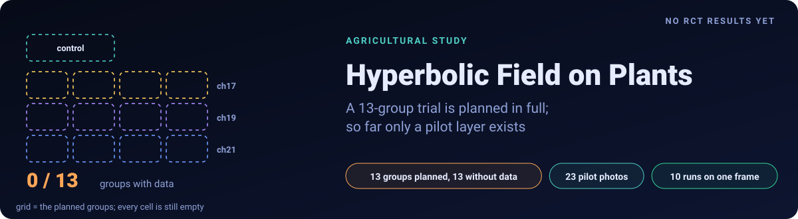
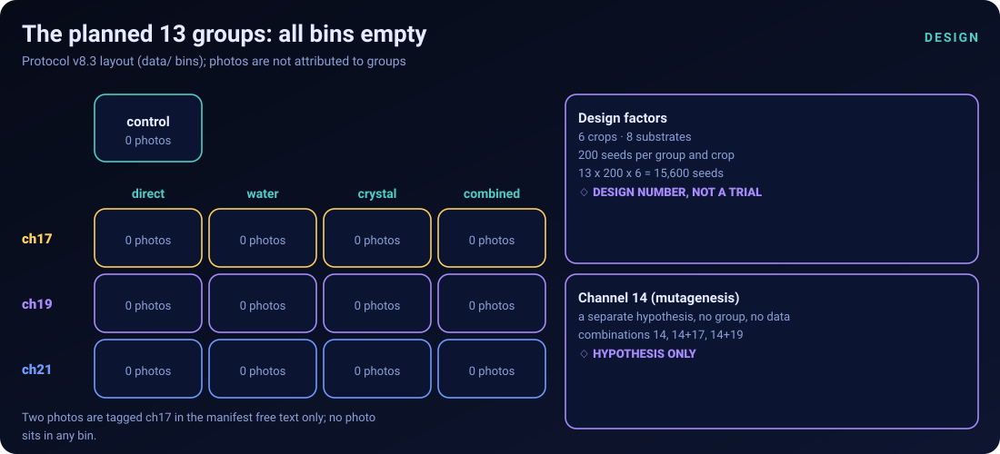
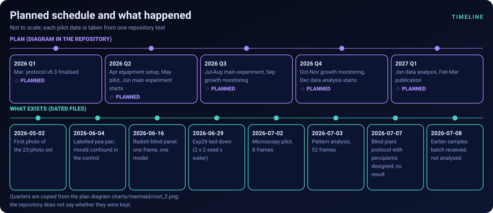
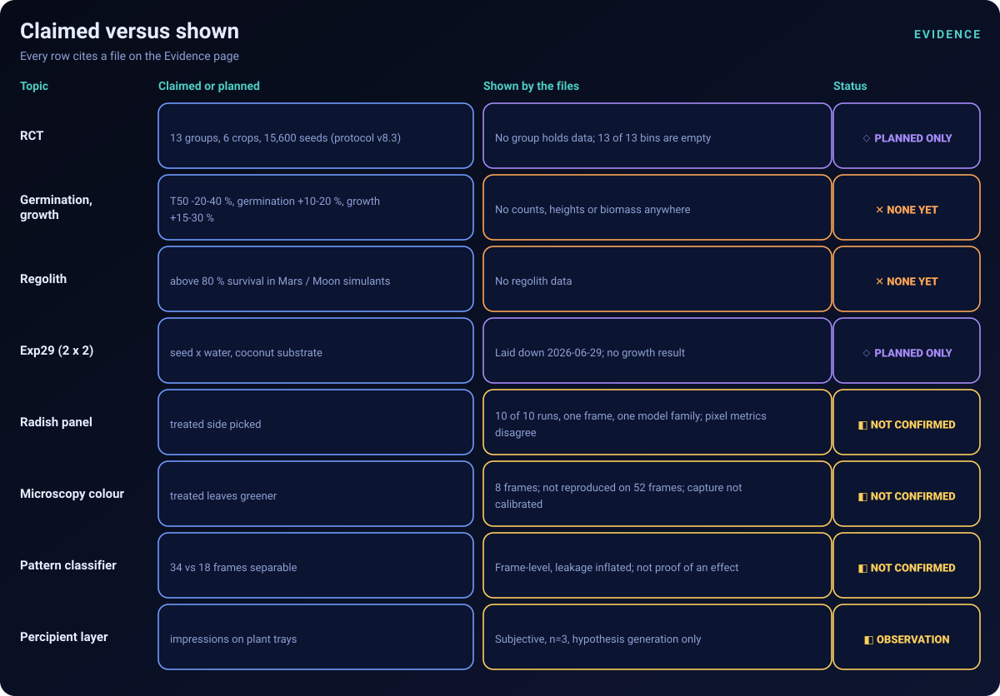
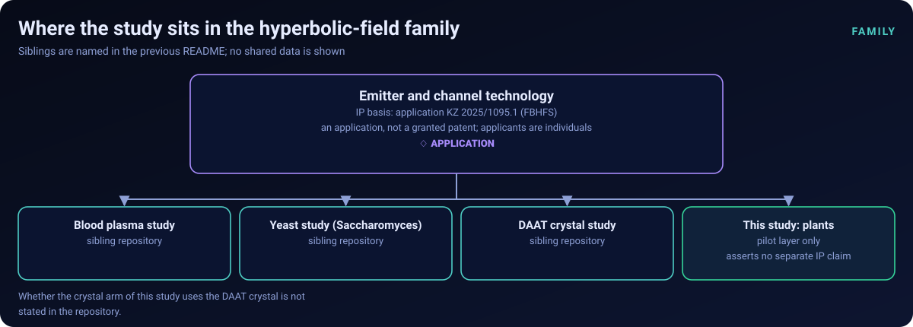

**English | [Русский](README.ru.md)**

<div align="center">



# HYPERBOLIC FIELD AGRICULTURAL STUDY

**Seed Germination, Plant Growth & Agricultural Yield Under Hyperbolic Field Exposure**

**Part of Advanced Scientific Research Projects (ASRP) Ecosystem**

[](https://github.com/AdvancedScientificResearchProjects)

<!-- badges -->


<!-- /badges -->

[](https://asrp.tech/en/patrons)

> **If this work is valuable to you — support us.** 7 patron tiers from Principal Philanthropist to Individual Contributor.
>
> **Support:** <https://asrp.tech/en/patrons><br>
> **Investment inquiries:** _pending — provide URL when available_

</div>

> A trial is planned in full; **no RCT results exist yet**, and the pilot analyses are preliminary. A patent application is an IP claim, not validation of an effect.

<!-- legacy-anchors --><a name="hyperbolic-field-agricultural-study--исследование-влияния-гиперболических-полей-на-сельское-хозяйство"></a><a name="navigation-index--навигационный-индекс"></a>
## At a glance

- **What it is.** The design of a planned randomized trial of hyperbolic-field exposure on seed germination and plant growth (<!--n:rct_bins-->13<!--/n--> groups, <!--n:crops-->6<!--/n--> crops, <!--n:substrates-->8<!--/n--> substrates, <!--n:seeds_total-->15,600<!--/n--> seeds, protocol <!--n:protocol_version-->v8.3<!--/n-->), plus a small pilot layer.
- **What was shown.** Nothing that decides the question. <!--n:rct_bins_empty-->13<!--/n--> of <!--n:rct_bins-->13<!--/n--> data bins are empty; there are <!--n:photos-->23<!--/n--> tray photos, one laid-down germination experiment (exp29) without a result, a blind-model comparison on one frame (<!--n:llm_correct-->10<!--/n--> of <!--n:llm_runs-->10<!--/n--> runs picked the treated side, pixel metrics did not agree) and two microscopy analyses.
- **What is not established.** Any effect on germination, growth, yield, regolith survival or water. The reports themselves call their signals preliminary: a <!--n:frames_total-->52<!--/n-->-frame pattern classifier is "reliably distinguishable at frame level but not proof of a treatment effect".
- **IP.** The study rests on emitter technology described in patent application KZ 2025/1095.1, **an application, not a granted patent**, and asserts no separate IP claim.
- **Where to start.** [Evidence](guide/EVIDENCE.md) for claimed versus shown; [Pilot data](guide/PILOT.md) for what exists.
- **What is open.** 13 gaps and inconsistencies, see [Open questions](guide/OPEN.md).

<!-- legacy-anchors --><a name="quick-navigation--быстрая-навигация"></a>
## Quick navigation

| &nbsp;&nbsp;Icon&nbsp;&nbsp; | Section | What is inside |
|:---:|---|---|
|  | **[The study](guide/STUDY.md)** | what it is, why it exists, key metrics, <!--n:goals-->7<!--/n--> goals, measurements |
|  | **[The plan](guide/DESIGN.md)** | protocol <!--n:protocol_version-->v8.3<!--/n-->: groups, channel 14, <!--n:substrates-->8<!--/n--> substrates, water protocol, schedule |
|  | **[Pilot data](guide/PILOT.md)** | <!--n:photos-->23<!--/n--> photos, exp29, the radish panel, two microscopy analyses, the percipient layer |
|  | **[Evidence](guide/EVIDENCE.md)** | claimed versus shown, each row with its source file |
|  | **[IP, team and ecosystem](guide/ECOSYSTEM.md)** | patent application, team, <!--n:issues_total-->7<!--/n--> issues, space context, sibling studies |
|  | **[Navigation and structure](guide/NAVIGATION.md)** | where things are, the data layout, the folder tree |
|  | **[Open questions](guide/OPEN.md)** | gaps and inconsistencies found, what was not verified |
|  | **[Ethics, IP and security](guide/ETHICS.md)** | what the study handles, classification, contact, disclaimer |

Full list: [guide index](guide/README.md).

**On this page:** [What this study is](#what-this-study-is) · [Key metrics and goals](#key-metrics-and-goals) · [The plan](#the-plan) · [What exists today](#what-exists-today) · [Claimed versus shown](#claimed-versus-shown) · [IP, team and ecosystem](#ip-team-and-ecosystem) · [Structure](#navigation-and-structure) · [Security](#security) · [Contact](#contact) · [Status](#status-of-the-previous-readme)

---

<!-- legacy-anchors --><a name="overview--обзор"></a><a name="en"></a><a name="ru"></a>
## What this study is

<!-- excerpt STUDY 0 -->
This repository holds the **design of a planned randomized controlled trial (RCT)** of hyperbolic-field exposure on seed germination, plant growth dynamics and agricultural yield, **plus a small pilot layer** of photographs and image analyses. The trial would compare direct exposure, water-mediated effects and crystal-based treatment across <!--n:crops-->6<!--/n--> crop varieties and <!--n:substrates-->8<!--/n--> substrates, including Mars and Moon regolith simulants for space agriculture.

**Read the data status before any result is inferred.** Protocol <!--n:protocol_version-->v8.3<!--/n--> is complete as a *text of intent*, but **no quantitative RCT results exist yet**: all <!--n:rct_bins-->13<!--/n--> group bins in `data/` are empty placeholders (<!--n:rct_bins_empty-->13<!--/n--> of <!--n:rct_bins-->13<!--/n-->). **No claim anywhere in the repository is confirmatory, statistically significant, dose-response, or based on completed trials.** Targets in the goals table below are protocol-defined hypotheses, not measured outcomes.

The pilot layer is real but small: <!--n:photos-->23<!--/n--> tray photographs, one laid-down germination experiment (exp29) without a result, a one-frame blind-model comparison, two microscopy analyses, and a subjective percipient layer. See [Pilot data](guide/PILOT.md) and [Evidence](guide/EVIDENCE.md).
<!-- /excerpt -->

Full page: [The study](guide/STUDY.md)

---

<!-- legacy-anchors --><a name="key-metrics--ключевые-метрики"></a><a name="research-goals--цели-исследования"></a><a name="measurements--измерения"></a>
## Key metrics and goals

<!-- excerpt STUDY 2 -->
These are design numbers of the plan, not outcomes. The seed total is the product of the groups, seeds per group and crops (checked at build time).

| Parameter | Value |
|---|---|
| **Study type** | Randomized controlled trial (RCT), planned |
| **Protocol version** | <!--n:protocol_version-->v8.3<!--/n--> (March 2026) |
| **Duration** | 196–226 days (~7 months), planned |
| **Treatment groups** | <!--n:rct_bins-->13<!--/n--> (1 control + 12 treatment) |
| **Crops** | <!--n:crops-->6<!--/n--> |
| **Seeds per group** | <!--n:seeds_per_group-->200<!--/n--> |
| **Total seeds** | <!--n:seeds_total-->15,600<!--/n--> |
| **Substrates** | <!--n:substrates-->8<!--/n--> (including Mars/Moon regolith simulants) |
| **Channels** | 17, 19, 21 (+ Channel 14 mutagenic) |
| **Patent** | KZ 2025/1095.1 (an application, not a granted patent) |
<!-- /excerpt -->

<!-- excerpt STUDY 3 -->
Seven measurable goals. The expected effects are **targets written into the plan**, not findings.

| Goal | Target | Expected effect (planned) |
|---|---|---|
| **G1** Germination acceleration | T50 (time to 50% germination) | -20–40% reduction |
| **G2** Germination rate | Germination percentage | +10–20% increase |
| **G3** Growth rate | Plant height, biomass | +15–30% increase |
| **G4** Stress resilience | Survival in poor substrates | >80% in regolith |
| **G5** Yield optimization | Seed yield per plant | +10–25% increase |
| **G6** Water treatment | Treated water effects | Measurable growth difference |
| **G7** Crystal treatment | Passive field effects | Validate crystal efficacy |
<!-- /excerpt -->

Full page: [The study](guide/STUDY.md)

---

<!-- legacy-anchors --><a name="experimental-design--экспериментальный-дизайн"></a><a name="treatment-groups--группы-обработки"></a><a name="channel-14-mutagenesis-hypothesis--канал-14-гипотеза-мутагенности"></a><a name="soil-substrate-matrix--матрица-почвенных-субстратов"></a><a name="water-treatment-protocol--протокол-обработки-воды"></a><a name="timeline--временная-шкала"></a>
## The plan

<!-- excerpt DESIGN 0 -->
<div align="center">
<a href="guide/assets/diagrams/design-matrix.en.svg"></a>
</div>

The planned trial has <!--n:rct_bins-->13<!--/n--> groups: one control and channels 17, 19 and 21, each in four modes (**direct** exposure, **water**, **crystal**, **combined**). With <!--n:crops-->6<!--/n--> crops, <!--n:substrates-->8<!--/n--> substrates and <!--n:seeds_per_group-->200<!--/n--> seeds per group and crop the design counts **<!--n:seeds_total-->15,600<!--/n-->** seeds. The protocol text of v8.3 itself is **not in this repository**; the plan is known from the previous README and the data layout. Everything below is a plan; the folders `data/<channel>-<mode>/` exist as <!--n:rct_bins_empty-->13<!--/n--> empty placeholders.
<!-- /excerpt -->

Full page: [The plan](guide/DESIGN.md)

---

<!-- legacy-anchors --><a name="preliminary-observations--предварительные-наблюдения"></a><a name="en-1"></a><a name="ru-1"></a>
## What exists today

<!-- excerpt PILOT 0 -->
<div align="center">
<a href="guide/assets/diagrams/timeline.en.svg"></a>
</div>

The repository holds **no RCT data**. What it holds is a **pilot layer** collected between <!--n:photo_first-->2026-05-02<!--/n--> and 2026-07-08, in six parts: a set of <!--n:photos-->23<!--/n--> tray photographs, the laid-down germination experiment exp29, a blind-model comparison on one radish frame, two microscopy analyses, a subjective percipient layer and an incoming batch under review. The repository's own reports call every one of them preliminary; none is a controlled, replicated result. Per-part detail and the verdict of each report are below; the claim-by-claim table is on the [Evidence](guide/EVIDENCE.md) page.
<!-- /excerpt -->

<!-- excerpt PILOT 1 -->
**Status: observational only, not an analysis, not confirmatory.** `data/photos/` holds **<!--n:photos-->23<!--/n--> photos** (<!--n:photos_jpeg-->18<!--/n--> JPEG + <!--n:photos_heic-->5<!--/n--> HEIC, <!--n:photo_first-->2026-05-02<!--/n--> to <!--n:photo_last-->2026-06-10<!--/n-->) of plant, pea, chickpea and microgreen trays, with one manifest entry per image. There are **no quantitative measurements** (no germination counts, T50, heights, biomass or scale bar) and channel attribution is incomplete.

- Only **one in-frame labelled pair** exists: a handwritten *irradiated* vs *control* pea/microgreen comparison from 2026-06-04 (single replicate, channel unspecified). In the control frame the microgreen tray shows **heavy white mould, an uncontrolled confound**, not a treatment effect.
- Two further 2026-06-10 microgreen photos are tagged `irradiated-ch17` **in manifest free text only** (no in-frame label, no paired control).
- **CH19 and CH21 have zero photographs.** All <!--n:rct_bins-->13<!--/n--> RCT bins (`control` + `ch17/ch19/ch21 × direct/water/crystal/combined`) are empty placeholders awaiting researcher attribution.

> **Caveat:** Nothing in the current data supports any effect-size, germination-percentage, dose-response or channel-specific claim. See [`data/README.md`](data/README.md) for what the data hub does NOT claim, and [`data/photos/README.md`](data/photos/README.md) for the per-image inventory.
<!-- /excerpt -->

Full page: [Pilot data](guide/PILOT.md)

---

## Claimed versus shown

<!-- excerpt EVIDENCE 0 -->
<div align="center">
<a href="guide/assets/diagrams/claimed-vs-shown.en.svg"></a>
</div>

**In one sentence:** the study has a complete plan and a small pilot layer, and **no result**. The plan states targets; the pilot reports say, in their own conclusions, that their signals are preliminary and not proof of a treatment effect. What follows is the full table, each row with the file it comes from. A plan, a protocol or a "will" is never counted as a result.
<!-- /excerpt -->

<!-- excerpt EVIDENCE 2 mode=images -->

<!-- /excerpt -->

Full page: [Evidence](guide/EVIDENCE.md)

---

<!-- legacy-anchors --><a name="patent-connection--связь-с-патентом"></a><a name="en-2"></a><a name="ru-2"></a><a name="research-team--команда"></a><a name="active-issues--tasks--активные-задачи"></a><a name="space-agriculture-context--контекст-космического-земледелия"></a><a name="asrp-ecosystem--экосистема-asrp"></a><a name="related-research-repositories--связанные-исследовательские-репозитории"></a><a name="patent-portfolio--патентный-портфель"></a>
## IP, team and ecosystem

<!-- excerpt ECOSYSTEM 0 -->
<div align="center">
<a href="guide/assets/diagrams/family-map.en.svg"></a>
</div>

This study belongs to ASRP's **hyperbolic-field** research family and uses the emitter and channel technology that is the IP basis of the **Fractal Biomedical System (FBHFS)** filing, shared across the hyperbolic-field studies (blood plasma, yeast, crystal, agriculture). That filing is **patent application KZ 2025/1095.1: an application, not a granted patent**. The previous README describes it as in substantive examination; this repository holds no independent confirmation of that status. This agricultural study is exploratory and asserts no separate IP claim of its own.

The repository does not name the applicants. An application is not a granted patent. The previous README lists the company only in its contact block and never says that it holds any patent.

| Patent | Application | Link |
|---|---|---|
| **Fractal Biomedical System** | KZ 2025/1095.1 | [View](https://github.com/denisbanchenko/Kazpatent_Fractal_Biomedical_System_Patent) |


<!-- /excerpt -->

Full page: [IP, team and ecosystem](guide/ECOSYSTEM.md)

---

<!-- legacy-anchors --><a name="data-structure--структура-данных"></a>
## Navigation and structure

Where to look: [`data/`](data/README.md) for observations, [`reports/`](reports/) for analyses, [`results/llm_blind/`](results/llm_blind/runs.json) for the blind-panel run data, [`protocols/`](protocols/2026-06-29_exp29-irradiated-germination.md) for the one protocol file. The tree below is generated from the real file list.

<!-- tree -->
```
ASRP_Hyperbolic_Field_Agricultural_Study/
├── README.md                                   # front page (English)
├── README.ru.md                                # front page (Russian)
├── guide/                                      # detail pages X.md + X.ru.md; assets/ = generated SVG
├── archive/                                    # the previous README, kept byte for byte
├── tools/                                      # showcase tooling: facts, visuals, excerpts, no-loss check
├── tests/                                      # regression gate for the showcase
├── charts/                                     # 3 Mermaid diagrams of the plan (root_1..3.png)
│   └── mermaid/                                # groups, timeline, patent link
├── data/                                       # photos, set-up photos, incoming batch, 13 empty RCT bins
│   ├── README.md                               # data hub: layers and what it does not claim
│   ├── photos/                                 # 23 photos (18 JPEG, 5 HEIC) + manifest.json
│   ├── exp29-setup/                            # 17 exp29 set-up files, incl. the handwritten protocol
│   ├── incoming/                               # batch of 2026-07-08 under review (media are git-ignored)
│   └── control/                                # RCT bins control, ch17/ch19/ch21 x 4 modes: placeholders
├── protocols/                                  # exp29 protocol (Russian only)
├── reports/                                    # 4 dated analyses (EN+RU) and a percipient layer
│   ├── 2026-06-16_llm-blind-photo/             # radish: blind model panel on one frame
│   ├── 2026-06-29_exp29-setup-observation/     # exp29 set-up observation (Russian only)
│   ├── 2026-07-02_microscopy-cell-structure/   # microscopy pilot, colour and cell shape
│   ├── 2026-07-03_pattern-embedding-analysis/  # 52 frames: embeddings, nuclei, patterns
│   └── percipient_reports/                     # subjective percipient layer (participant folders not described)
├── results/                                    # llm_blind: 10 runs and their key
└── scripts/                                    # llm_analysis: the blind-panel script
```
<!-- /tree -->

Full page: [Navigation and structure](guide/NAVIGATION.md) · the previous README is kept in [`archive/`](archive/README_2026-11-19_pre-showcase.md).

## Open questions

The main gaps, each described with its source on [Open questions](guide/OPEN.md): the protocol v8.3 text is not in the repository; the status header lags the pilot work; the README says "no quantitative results" while three reports give pilot numbers; the microscopy pilot reports 8 frames but its key lists 9; the radish frame is absent from the photo manifest; it is not stated which crystal the crystal arm uses; the patent status is not independently confirmed.

---

<!-- legacy-anchors --><a name="security--безопасность"></a><a name="data-classification--классификация-данных"></a>
## Security

<!-- excerpt ETHICS 1 -->
| Level | Access | Marking | Description |
|---|---|---|---|
| **PUBLIC** | Open | GREEN | General information |
| **RESEARCH** | Team Only | YELLOW | Research data |
| **RESTRICTED** | Core Team | RED | Sensitive analysis |
| **INTERNAL** | Director Only | BLACK | Director-level review only |

The repository does not say which of its folders sits on which level; that mapping is an [open question](guide/OPEN.md).
<!-- /excerpt -->

Full page: [Ethics, IP and security](guide/ETHICS.md)

---

<!-- legacy-anchors --><a name="contact-information--контактная-информация"></a>
## Contact

<!-- excerpt ETHICS 4 -->
| Field | Value |
|---|---|
| **Organization** | ТОО "Перспективные Научно-Исследовательские Разработки" / Advanced Scientific Research Projects LLP |
| **Country** | Republic of Kazakhstan |
| **Website** | [asrp.tech](https://asrp.tech) |
| **Email** | info@asrp.tech |

The address row of the previous README is kept in [`archive/README_2026-11-19_pre-showcase.md`](archive/README_2026-11-19_pre-showcase.md) and is not repeated here.
<!-- /excerpt -->

---

<!-- legacy-anchors --><a name="tbd--в-работе"></a>
## Status of the previous README

<div align="center">

**Last Updated:** July 2026

**Status:** Protocol Complete, Equipment Setup Pending

</div>

The two lines above are kept from the previous README as written; they are older than the pilot work described here. Items it listed as still to do (TBD):

- Seed photos BEFORE/DURING/AFTER exposure
- Equipment setup photos

> All findings are preliminary and subject to validation.
