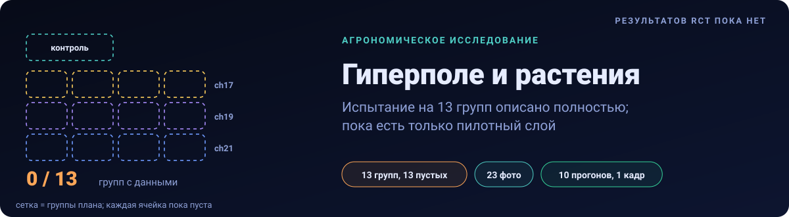
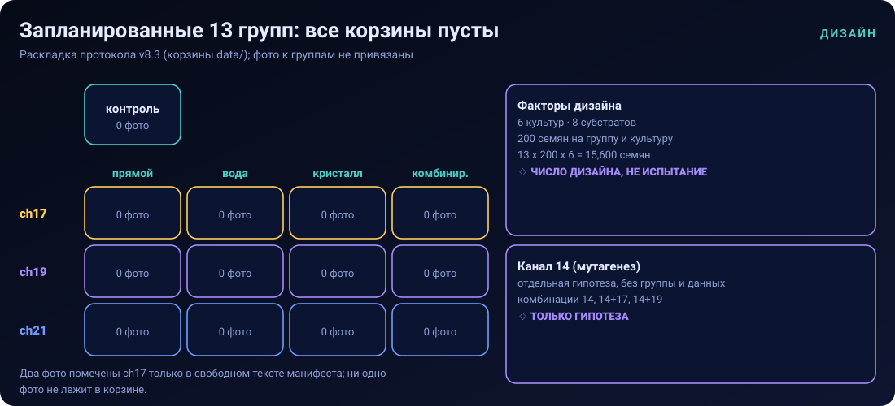
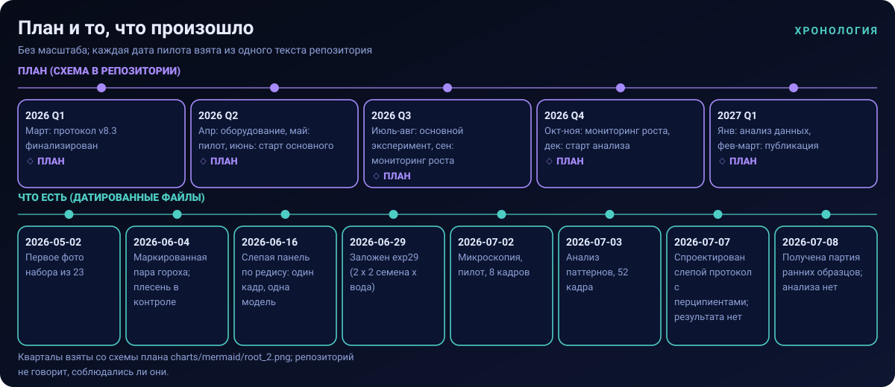
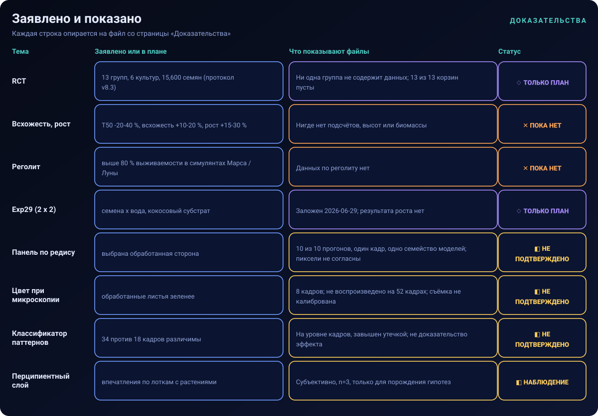
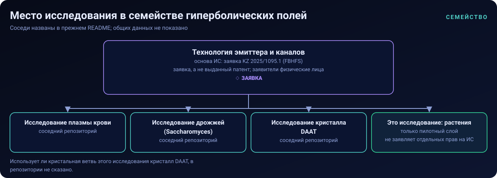
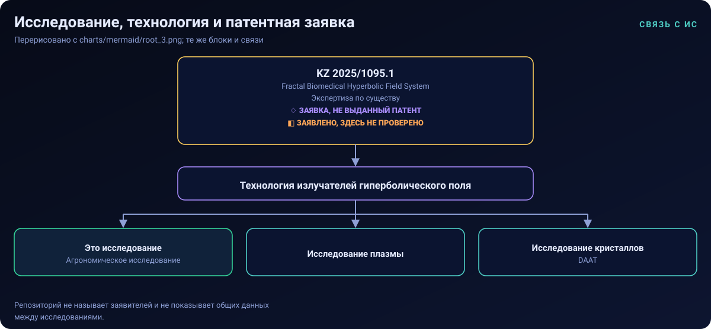

**[English](README.md) | Русский**

<div align="center">



# ИССЛЕДОВАНИЕ ВЛИЯНИЯ ГИПЕРБОЛИЧЕСКИХ ПОЛЕЙ НА СЕЛЬСКОЕ ХОЗЯЙСТВО

**Прорастание семян, рост растений и урожайность под воздействием гиперболических полей**

**Часть экосистемы ASRP (Advanced Scientific Research Projects)**

[](https://github.com/AdvancedScientificResearchProjects)

<!-- badges -->


<!-- /badges -->

[](https://asrp.tech/en/patrons)

> **Если эта работа вам полезна — поддержите нас.** 7 уровней меценатства — от Главного Филантропа до Индивидуального Вкладчика.
>
> **Поддержать:** <https://asrp.tech/en/patrons><br>
> **Инвестиционные запросы:** _в ожидании — добавляется при предоставлении_

</div>

> Испытание описано полностью; **результатов RCT пока нет**, а пилотные анализы предварительны. Патентная заявка — это притязание на ИС, а не подтверждение эффекта.

## Коротко

- **Что это.** Дизайн запланированного рандомизированного испытания влияния гиперболических полей на прорастание семян и рост растений (<!--n:rct_bins-->13<!--/n--> групп, <!--n:crops-->6<!--/n--> культур, <!--n:substrates-->8<!--/n--> субстратов, <!--n:seeds_total-->15,600<!--/n--> семян, протокол <!--n:protocol_version-->v8.3<!--/n-->) плюс небольшой пилотный слой.
- **Что показано.** Ничего, что решает вопрос. <!--n:rct_bins_empty-->13<!--/n--> из <!--n:rct_bins-->13<!--/n--> корзин данных пусты; есть <!--n:photos-->23<!--/n--> фото лотков, один заложенный эксперимент прорастания (exp29) без результата, слепое сравнение моделей на одном кадре (<!--n:llm_correct-->10<!--/n--> из <!--n:llm_runs-->10<!--/n--> прогонов выбрали обработанную сторону, пиксельные метрики не согласились) и два микроскопических анализа.
- **Что не установлено.** Любой эффект на всхожесть, рост, урожай, выживаемость в реголите или воду. Сами отчёты называют свои сигналы предварительными: классификатор паттернов на <!--n:frames_total-->52<!--/n--> кадрах «надёжно различает на уровне кадров, но это не доказательство эффекта обработки».
- **ИС.** Исследование опирается на технологию эмиттера, описанную в патентной заявке KZ 2025/1095.1, **заявке, а не выданном патенте**, и не заявляет отдельных прав на ИС.
- **С чего начать.** [Доказательства](guide/EVIDENCE.ru.md) — заявлено и показано; [Пилотные данные](guide/PILOT.ru.md) — что есть.
- **Что открыто.** 13 пробелов и несоответствий, см. [Открытые вопросы](guide/OPEN.ru.md).

## Быстрая навигация

| &nbsp;&nbsp;Значок&nbsp;&nbsp; | Раздел | Что внутри |
|:---:|---|---|
|  | **[Исследование](guide/STUDY.ru.md)** | что это, зачем оно, ключевые метрики, <!--n:goals-->7<!--/n--> целей, измерения |
|  | **[План](guide/DESIGN.ru.md)** | протокол <!--n:protocol_version-->v8.3<!--/n-->: группы, канал 14, <!--n:substrates-->8<!--/n--> субстратов, протокол воды, сроки |
|  | **[Пилотные данные](guide/PILOT.ru.md)** | <!--n:photos-->23<!--/n--> фото, exp29, панель по редису, два микроскопических анализа, перципиентный слой |
|  | **[Доказательства](guide/EVIDENCE.ru.md)** | заявлено и показано, у каждой строки файл-источник |
|  | **[ИС, команда и экосистема](guide/ECOSYSTEM.ru.md)** | патентная заявка, команда, <!--n:issues_total-->7<!--/n--> задач, космический контекст, соседние исследования |
|  | **[Галерея рисунков](guide/FIGURES.ru.md)** | все рисунки и наборы фото репозитория: что показывают и где лежат |
|  | **[Навигация и структура](guide/NAVIGATION.ru.md)** | где что лежит, раскладка данных, дерево папок |
|  | **[Открытые вопросы](guide/OPEN.ru.md)** | найденные пробелы и несоответствия, что не проверено |
|  | **[Этика, ИС и безопасность](guide/ETHICS.ru.md)** | с чем работает исследование, классификация, контакты, оговорка |

Полный список: [указатель](guide/README.ru.md).

**На этой странице:** [Что это за исследование](#что-это-за-исследование) · [Метрики и цели](#ключевые-метрики-и-цели) · [План](#план) · [Что есть сегодня](#что-есть-сегодня) · [Заявлено и показано](#заявлено-и-показано) · [ИС, команда и экосистема](#ис-команда-и-экосистема) · [Структура](#навигация-и-структура) · [Безопасность](#безопасность) · [Контакты](#контакты) · [Статус](#статус-прежнего-readme)

---

## Что это за исследование

<!-- excerpt STUDY 0 -->
В репозитории лежит **дизайн запланированного рандомизированного контролируемого испытания (РКИ)** воздействия гиперболических полей на прорастание семян, динамику роста растений и урожайность, **плюс небольшой пилотный слой** фотографий и анализов изображений. Испытание сравнивало бы прямое воздействие, эффекты через воду и обработку кристаллами на <!--n:crops-->6<!--/n--> культурах и <!--n:substrates-->8<!--/n--> субстратах, включая симулянты марсианского и лунного реголита для космического земледелия.

**Прочитайте статус данных, прежде чем делать выводы о результатах.** Протокол <!--n:protocol_version-->v8.3<!--/n--> завершён (так сказано в прежнем README; его текста в этом репозитории нет), но **количественных результатов РКИ пока нет**: все <!--n:rct_bins-->13<!--/n--> корзин групп в `data/` пустые плейсхолдеры (<!--n:rct_bins_empty-->13<!--/n--> из <!--n:rct_bins-->13<!--/n-->). **Ни одно утверждение в репозитории не является подтверждённым, статистически значимым, дозозависимым или основанным на завершённых испытаниях.** Целевые значения в таблице целей ниже — гипотезы, заданные протоколом, а не измеренные результаты.

Пилотный слой реален, но мал: <!--n:photos-->23<!--/n--> фотографий лотков, один заложенный эксперимент прорастания (exp29) без результата, слепое сравнение моделей на одном кадре, два микроскопических анализа и субъективный перципиентный слой. См. [Пилотные данные](guide/PILOT.ru.md) и [Доказательства](guide/EVIDENCE.ru.md).
<!-- /excerpt -->

Полная страница: [Исследование](guide/STUDY.ru.md)

---

## Ключевые метрики и цели

<!-- excerpt STUDY 2 -->
Это числа дизайна плана, а не итоги. Общее число семян равно произведению групп, семян на группу и культур (проверяется при сборке).

| Параметр | Значение |
|---|---|
| **Тип исследования** | Рандомизированное контролируемое испытание (РКИ), запланировано |
| **Версия протокола** | <!--n:protocol_version-->v8.3<!--/n--> (Март 2026) |
| **Длительность** | 196–226 дней (~7 месяцев), по плану |
| **Группы обработки** | <!--n:rct_bins-->13<!--/n--> (1 контроль + 12 обработка) |
| **Культуры** | <!--n:crops-->6<!--/n--> |
| **Семян на группу** | <!--n:seeds_per_group-->200<!--/n--> |
| **Всего семян** | <!--n:seeds_total-->15,600<!--/n--> |
| **Субстраты** | <!--n:substrates-->8<!--/n--> (включая симулянты марсианского/лунного реголита) |
| **Каналы** | 17, 19, 21 (+ канал 14 мутагенный) |
| **Патент** | KZ 2025/1095.1 (заявка, а не выданный патент) |
<!-- /excerpt -->

<!-- excerpt STUDY 3 -->
Семь измеримых целей. Ожидаемые эффекты — **целевые значения плана**, а не находки.

| Цель | Показатель | Ожидаемый эффект (по плану) |
|---|---|---|
| **G1** Ускорение прорастания | T50 (время до 50% всхожести) | Сокращение на 20–40% |
| **G2** Показатель всхожести | Процент всхожести | Увеличение на 10–20% |
| **G3** Скорость роста | Высота растения, биомасса | Увеличение на 15–30% |
| **G4** Стресс-устойчивость | Выживание в бедных субстратах | >80% в реголите |
| **G5** Оптимизация урожая | Урожай семян на растение | Увеличение на 10–25% |
| **G6** Обработка воды | Эффекты обработанной воды | Измеримая разница в росте |
| **G7** Обработка кристаллами | Пассивные эффекты поля | Валидация кристаллов |
<!-- /excerpt -->

Полная страница: [Исследование](guide/STUDY.ru.md)

---

## План

<!-- excerpt DESIGN 0 -->
<div align="center">
<a href="guide/assets/diagrams/design-matrix.ru.svg"></a>
</div>

В плане <!--n:rct_bins-->13<!--/n--> групп: один контроль и каналы 17, 19 и 21, каждый в четырёх режимах (**прямое** воздействие, **вода**, **кристалл**, **комбинированный**). При <!--n:crops-->6<!--/n--> культурах, <!--n:substrates-->8<!--/n--> субстратах и <!--n:seeds_per_group-->200<!--/n--> семенах на группу и культуру дизайн насчитывает **<!--n:seeds_total-->15,600<!--/n-->** семян. Текста протокола v8.3 **в репозитории нет**; план известен по прежнему README и раскладке данных. Всё ниже — план; папки `data/<канал>-<режим>/` существуют как <!--n:rct_bins_empty-->13<!--/n--> пустых плейсхолдеров.
<!-- /excerpt -->

Полная страница: [План](guide/DESIGN.ru.md)

---

## Что есть сегодня

<!-- excerpt PILOT 0 -->
<div align="center">
<a href="guide/assets/diagrams/timeline.ru.svg"></a>
</div>

В репозитории **нет данных RCT**. Есть **пилотный слой**, собранный между <!--n:photo_first-->2026-05-02<!--/n--> и 2026-07-08, из шести частей: набор из <!--n:photos-->23<!--/n--> фотографий лотков, заложенный эксперимент прорастания exp29, слепое сравнение моделей на одном кадре редиса, два микроскопических анализа, субъективный перципиентный слой и входящая партия на рассмотрении. Собственные отчёты репозитория называют каждую из них предварительной; ни одна не является контролируемым воспроизведённым результатом. Подробности по частям и вердикт каждого отчёта — ниже; таблица по утверждениям — на странице [Доказательства](guide/EVIDENCE.ru.md).
<!-- /excerpt -->

<!-- excerpt PILOT 1 -->
**Статус: только наблюдение, не анализ, не подтверждение.** В `data/photos/` лежат **<!--n:photos-->23<!--/n--> фото** (<!--n:photos_jpeg-->18<!--/n--> JPEG + <!--n:photos_heic-->5<!--/n--> HEIC, 02.05.2026 → 10.06.2026) лотков с растениями, горохом, нутом и микрозеленью, по одной записи манифеста на изображение. **Количественных измерений нет** (нет подсчётов всхожести, T50, высот, биомассы или масштабной линейки), атрибуция по каналам неполная.

- Существует только **одна маркированная в кадре пара**: рукописное сравнение *облучённые* vs *контроль* (горох/микрозелень) от 04.06.2026 (один повтор, канал не указан). В контрольном кадре на лотке микрозелени **обильная белая плесень — неконтролируемый конфаундер**, а не эффект обработки.
- Ещё две фотографии микрозелени от 10.06.2026 помечены `irradiated-ch17` **только в свободном тексте манифеста** (нет метки в кадре, нет парного контроля).
- **Для CH19 и CH21 фотографий ноль.** Все <!--n:rct_bins-->13<!--/n--> корзин RCT (`control` + `ch17/ch19/ch21 × direct/water/crystal/combined`) — пустые плейсхолдеры, ожидающие атрибуции руководителя.

> **Оговорка:** ничто в текущих данных не подтверждает какое-либо утверждение о размере эффекта, проценте всхожести, дозозависимости или специфике канала. См. [`data/README.md`](data/README.md) — чего хаб данных НЕ утверждает, и [`data/photos/README.md`](data/photos/README.md) — поэлементный список.
<!-- /excerpt -->

Полная страница: [Пилотные данные](guide/PILOT.ru.md)

---

## Заявлено и показано

<!-- excerpt EVIDENCE 0 -->
<div align="center">
<a href="guide/assets/diagrams/claimed-vs-shown.ru.svg"></a>
</div>

**В одном предложении:** у исследования есть полный план и небольшой пилотный слой, и **нет результата**. План называет целевые значения; пилотные отчёты сами пишут в выводах, что их сигналы предварительны и не доказывают эффекта обработки. Ниже полная таблица, у каждой строки файл-источник. План, протокол или «будет» никогда не считаются результатом.
<!-- /excerpt -->

<!-- excerpt EVIDENCE 2 mode=images -->

<!-- /excerpt -->

Полная страница: [Доказательства](guide/EVIDENCE.ru.md)

---

## ИС, команда и экосистема

<!-- excerpt ECOSYSTEM 0 -->
<div align="center">
<a href="guide/assets/diagrams/family-map.ru.svg"></a>
</div>

Исследование относится к исследовательскому семейству **гиперболических полей** ASRP и использует технологию эмиттера и каналов, лежащую в основе заявки **Fractal Biomedical System (FBHFS)**, общей для исследований гиперболического поля (плазма крови, дрожжи, кристалл, сельское хозяйство). Эта заявка — **патентная заявка KZ 2025/1095.1: заявка, а не выданный патент**. Прежний README описывает её как проходящую экспертизу по существу; независимого подтверждения этого статуса в репозитории нет. Данное агрономическое исследование носит поисковый характер и не заявляет отдельных прав на интеллектуальную собственность.

Репозиторий не называет заявителей. Заявка — не выданный патент. Прежний README упоминает компанию только в блоке контактов и нигде не говорит, что она владеет каким-либо патентом.

| Патент | Заявка | Ссылка |
|---|---|---|
| **Фрактальная биомедицинская система** | KZ 2025/1095.1 | [Просмотр](https://github.com/denisbanchenko/Kazpatent_Fractal_Biomedical_System_Patent) |



Исходная схема: [`charts/mermaid/root_3.png`](charts/mermaid/root_3.png)
<!-- /excerpt -->

Полная страница: [ИС, команда и экосистема](guide/ECOSYSTEM.ru.md)

---

## Навигация и структура

Где смотреть: [`data/`](data/README.md) — наблюдения, [`reports/`](reports/) — анализы, [`results/llm_blind/`](results/llm_blind/runs.json) — данные прогонов слепой панели, [`protocols/`](protocols/2026-06-29_exp29-irradiated-germination.md) — единственный файл протокола. Дерево ниже строится по реальному списку файлов.

<!-- tree -->
```
ASRP_Hyperbolic_Field_Agricultural_Study/
├── README.md                                   # главная страница (английская)
├── README.ru.md                                # главная страница (русская)
├── guide/                                      # страницы-детали X.md + X.ru.md; assets/ = сгенерированные SVG
├── archive/                                    # прежний README, сохранён байт в байт
├── tools/                                      # инструменты витрины: факты, визуалы, выдержки, проверка без потерь
├── tests/                                      # регрессионный гейт витрины
├── charts/                                     # 3 диаграммы Mermaid плана (root_1..3.png)
│   └── mermaid/                                # группы, хронология, связь с патентом
├── data/                                       # фото, фото закладки, входящая партия, 13 пустых корзин RCT
│   ├── README.md                               # хаб данных: слои и чего он не утверждает
│   ├── photos/                                 # 23 фото (18 JPEG, 5 HEIC) + manifest.json
│   ├── exp29-setup/                            # 17 файла закладки exp29, вкл. рукописный протокол
│   ├── incoming/                               # партия 2026-07-08 на рассмотрении (медиа в .gitignore)
│   └── control/                                # корзины RCT control, ch17/ch19/ch21 x 4 режима: плейсхолдеры
├── protocols/                                  # протокол exp29 (только на русском)
├── reports/                                    # 4 датированных анализа (EN+RU) и перципиентный слой
│   ├── 2026-06-16_llm-blind-photo/             # редис: слепая панель моделей по одному кадру
│   ├── 2026-06-29_exp29-setup-observation/     # наблюдение закладки exp29 (только на русском)
│   ├── 2026-07-02_microscopy-cell-structure/   # микроскопия, пилот: цвет и форма клеток
│   ├── 2026-07-03_pattern-embedding-analysis/  # 52 кадра: эмбеддинги, ядра, паттерны
│   └── percipient_reports/                     # субъективный перципиентный слой (папки участников не описаны)
├── results/                                    # llm_blind: 10 прогонов и ключ
└── scripts/                                    # llm_analysis: скрипт слепой панели
```
<!-- /tree -->

Полная страница: [Навигация и структура](guide/NAVIGATION.ru.md) · прежний README хранится в [`archive/`](archive/README_2026-11-19_pre-showcase.md).

## Открытые вопросы

Основные пробелы, каждый описан с источником на странице [Открытые вопросы](guide/OPEN.ru.md): текста протокола v8.3 в репозитории нет; заголовок статуса отстаёт от пилотной работы; README говорит «количественных результатов нет», а три отчёта дают пилотные числа; микроскопический пилот называет 8 кадров, а его ключ перечисляет 9; кадра редиса нет в манифесте фото; не сказано, какой кристалл использует ветвь с кристаллом; статус патента независимо не подтверждён.

---

## Безопасность

<!-- excerpt ETHICS 1 -->
| Уровень | Доступ | Маркировка | Описание |
|---|---|---|---|
| **ПУБЛИЧНЫЙ** | Открытый | ЗЕЛЁНЫЙ | Общая информация |
| **ИССЛЕДОВАТЕЛЬСКИЙ** | Только команда | ЖЁЛТЫЙ | Исследовательские данные |
| **ОГРАНИЧЕННЫЙ** | Основная команда | КРАСНЫЙ | Конфиденциальный анализ |
| **ВНУТРЕННИЙ** | Только директор | ЧЁРНЫЙ | Только обзор уровня директора |

Репозиторий не говорит, какая из его папок на каком уровне; это [открытый вопрос](guide/OPEN.ru.md).
<!-- /excerpt -->

Полная страница: [Этика, ИС и безопасность](guide/ETHICS.ru.md)

---

## Контакты

<!-- excerpt ETHICS 4 -->
| Поле | Значение |
|---|---|
| **Организация** | ТОО "Перспективные Научно-Исследовательские Разработки" / Advanced Scientific Research Projects LLP |
| **Страна** | Республика Казахстан |
| **Веб-сайт** | [asrp.tech](https://asrp.tech) |
| **Email** | info@asrp.tech |

Строка с адресом прежнего README сохранена в [`archive/README_2026-11-19_pre-showcase.md`](archive/README_2026-11-19_pre-showcase.md) и здесь не повторяется.
<!-- /excerpt -->

---

## Статус прежнего README

<div align="center">

**Последнее обновление:** Июль 2026

**Статус:** протокол готов, подготовка оборудования

</div>

Две строки выше сохранены из прежнего README как были написаны; они старше описанной здесь пилотной работы. Пункты, которые он числил как ещё предстоящие (TBD):

- Фото семян ДО/ВО ВРЕМЯ/ПОСЛЕ воздействия
- Фото установки оборудования

> Все выводы предварительны и требуют проверки.
