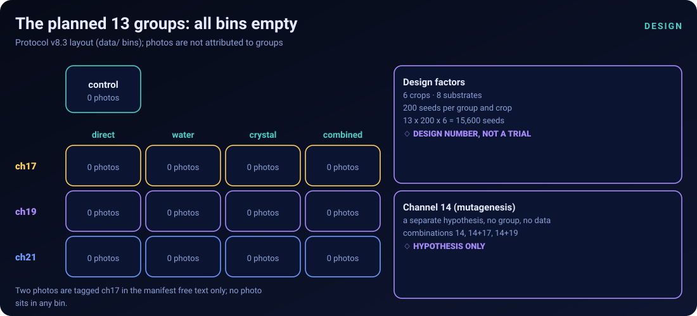

**English | [Русский](DESIGN.ru.md)**

[← Hyperbolic Field Agricultural Study](../README.md) · [Guide index](README.md)

# The plan: protocol v8.3

## The plan in one picture

The planned trial has <!--n:rct_bins-->13<!--/n--> groups: one control and channels 17, 19 and 21, each in four modes (**direct** exposure, **water**, **crystal**, **combined**). With <!--n:crops-->6<!--/n--> crops, <!--n:substrates-->8<!--/n--> substrates and <!--n:seeds_per_group-->200<!--/n--> seeds per group and crop the design counts **<!--n:seeds_total-->15,600<!--/n-->** seeds. The protocol text of v8.3 itself is **not in this repository**; the plan is known from the previous README and the data layout. Everything below is a plan; the folders `data/<channel>-<mode>/` exist as <!--n:rct_bins_empty-->13<!--/n--> empty placeholders.

## Treatment groups

> **Channel 14 (Mutagenic):** Separate investigation of mutagenic effects on seed germination, which must be included in the hypotheses.

## Channel 14: mutagenesis hypothesis

Hyperbolic radiation on channel 14 presumably induces mutagenesis in plants, analogous to classical gamma irradiation, but through a hyperbolic field. The goal is to obtain new plant varieties with novel properties. In the classical approach, a large sample (thousands of seeds) is irradiated with gamma radiation, then mutations are analyzed. The plan uses hyperbolic radiation instead of gamma. Possible channel combinations: 14, 14+17, 14+19. **No data on this hypothesis exists in the repository.**

## Soil substrate matrix

| Code | Substrate | Purpose |
|---|---|---|
| **S0** | Germination base | Baseline |
| **S1** | Nutrient gauze | Hydroponic |
| **S2** | Poor soil | Stress test |
| **S3** | Medium soil | Standard |
| **S4** | Rich soil | Optimal |
| **S5** | Stony soil | Stress test |
| **S6** | Mars regolith simulant (JSC Mars-1) | Space agriculture |
| **S7** | Moon regolith simulant (LMS-1) | Space agriculture |

## Water treatment protocol

| Parameter | Value |
|---|---|
| **Water type** | Distilled |
| **Volume** | 5L per treatment |
| **Container** | Glass beaker |
| **Distance from emitter** | 10 cm |
| **Exposure time** | 60 min |
| **Channels** | 17, 19, 21 |
| **Temperature** | 20–22°C |
| **Usage window** | Within 24h |

The emitter hardware itself is not described anywhere in the repository.

## Planned timeline

The schedule is about 7 months in 7 phases: protocol finalisation in March 2026, equipment set-up in April, a pilot in May, the main experiment from June, growth monitoring, data analysis from December, publication in February-March 2027. Issues #4 to #8 for these phases are still open on the previous README's list, with due dates in Q2-Q3 2026 ([ecosystem page](ECOSYSTEM.md#active-issues-and-tasks)). The dated pilot work that did happen is on the [timeline](PILOT.md#what-exists-today).
