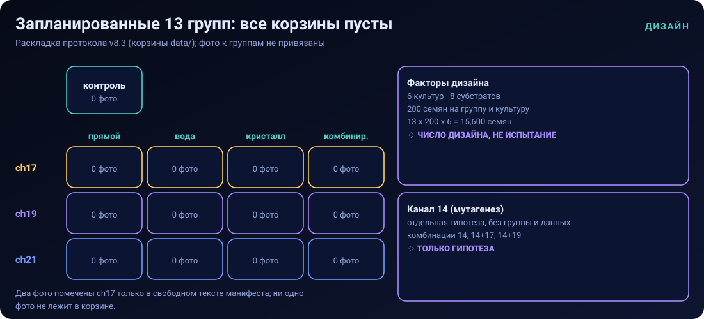

**[English](DESIGN.md) | Русский**

[← Исследование влияния гиперболических полей на сельское хозяйство](../README.ru.md) · [Указатель](README.ru.md)

# План: протокол v8.3

## План на одной картинке

В плане <!--n:rct_bins-->13<!--/n--> групп: один контроль и каналы 17, 19 и 21, каждый в четырёх режимах (**прямое** воздействие, **вода**, **кристалл**, **комбинированный**). При <!--n:crops-->6<!--/n--> культурах, <!--n:substrates-->8<!--/n--> субстратах и <!--n:seeds_per_group-->200<!--/n--> семенах на группу и культуру дизайн насчитывает **<!--n:seeds_total-->15,600<!--/n-->** семян. Текста протокола v8.3 **в репозитории нет**; план известен по прежнему README и раскладке данных. Всё ниже — план; папки `data/<канал>-<режим>/` существуют как <!--n:rct_bins_empty-->13<!--/n--> пустых плейсхолдеров.

## Группы обработки

> **Канал 14 (мутагенный):** отдельное исследование мутагенных эффектов на прорастание семян — должен быть включён в гипотезы.

## Канал 14: гипотеза мутагенности

Гиперболическое излучение на 14-м канале предположительно вызывает мутагенность в растениях — аналогично классическому гамма-облучению, но через гиперболическое поле. Цель — получение растений новых видов с новыми свойствами. В классическом подходе берётся большая выборка (тысячи семян), облучается гамма-излучением, затем анализируются мутации. План использует гиперболическое излучение вместо гамма. Возможные комбинации каналов: 14, 14+17, 14+19. **Данных по этой гипотезе в репозитории нет.**

## Матрица почвенных субстратов

| Код | Субстрат | Назначение |
|---|---|---|
| **S0** | Основа прорастания | Базовая линия |
| **S1** | Питательная марля | Гидропоника |
| **S2** | Бедная почва | Стресс-тест |
| **S3** | Средняя почва | Стандарт |
| **S4** | Богатая почва | Оптимум |
| **S5** | Каменистая почва | Стресс-тест |
| **S6** | Симулянт марсианского реголита (JSC Mars-1) | Космическое земледелие |
| **S7** | Симулянт лунного реголита (LMS-1) | Космическое земледелие |

## Протокол обработки воды

| Параметр | Значение |
|---|---|
| **Тип воды** | Дистиллированная |
| **Объём** | 5 л на обработку |
| **Ёмкость** | Стеклянный стакан |
| **Расстояние от эмиттера** | 10 см |
| **Время воздействия** | 60 мин |
| **Каналы** | 17, 19, 21 |
| **Температура** | 20–22°C |
| **Окно использования** | В течение 24ч |

Сама аппаратура эмиттера нигде в репозитории не описана.

## Плановые сроки

Расписание — около 7 месяцев в 7 фазах: финализация протокола в марте 2026, настройка оборудования в апреле, пилот в мае, основной эксперимент с июня, мониторинг роста, анализ данных с декабря, публикация в феврале-марте 2027. Задачи #4-#8 по этим фазам в списке прежнего README всё ещё открыты, со сроками на Q2-Q3 2026 ([страница экосистемы](ECOSYSTEM.ru.md#активные-задачи)). Датированная пилотная работа, которая действительно была, — на [хронологии](PILOT.ru.md#что-есть-сегодня).
