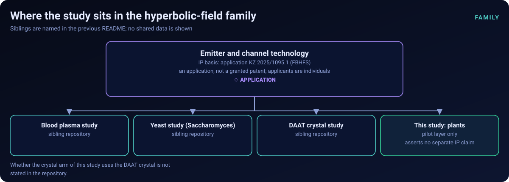
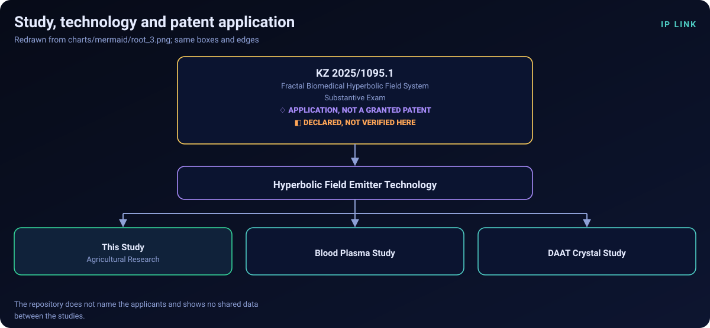

**English | [Русский](ECOSYSTEM.ru.md)**

[← Hyperbolic Field Agricultural Study](../README.md) · [Guide index](README.md)

# IP, team and ecosystem

## Patent connection

This study belongs to ASRP's **hyperbolic-field** research family and uses the emitter and channel technology that is the IP basis of the **Fractal Biomedical System (FBHFS)** filing, shared across the hyperbolic-field studies (blood plasma, yeast, crystal, agriculture). That filing is **patent application KZ 2025/1095.1: an application, not a granted patent**. The previous README describes it as in substantive examination; this repository holds no independent confirmation of that status. This agricultural study is exploratory and asserts no separate IP claim of its own.

The repository does not name the applicants. An application is not a granted patent. The previous README lists the company only in its contact block and never says that it holds any patent.

| Patent | Application | Link |
|---|---|---|
| **Fractal Biomedical System** | KZ 2025/1095.1 | [View](https://github.com/denisbanchenko/Kazpatent_Fractal_Biomedical_System_Patent) |

Original figure: [`charts/mermaid/root_3.png`](../charts/mermaid/root_3.png)

## Research team

| Name | Role | Responsibilities |
|---|---|---|
| **Valeria Ovsyannikova** | Director of Biomedical Research Department; Chief Researcher & Head of Experimental Work | Author of the experimental program and methodology; research infrastructure and hardware development; full-cycle research; hyperbolic field physics |
| **Ivan Savelyev** | Science Director & Editor-in-Chief of ASRP.science | Scientific direction |
| **Mykhailo Kapustin** | CTO & Director of AI and IT Department | IT infrastructure |
| **Kyryl Zmiienko** | Chief AI Engineer | AI/ML analysis |
| **Alexandr Ovsyannikov** | Head Hardware Engineer | Electrical systems |
| **Denis Banchenko** | Program Director, Author of Research Methodology & Technology | Project management, hyperbolic field physics |
| **Olesya Chirkova** | Consultant | Blood plasma methodology |

**Collaborator:** SASU Point Rouge, France (Chirkova). Its role in this study is not described.

## Active issues and tasks

The list is copied from the previous README (not re-read from GitHub): <!--n:issues_done-->2<!--/n--> complete, <!--n:issues_open-->5<!--/n--> open. The open phase issues carry due dates in Q2-Q3 2026.

| # | Title | Priority | Due | Status |
|---|---|---|---|---|
| [#1](https://github.com/AdvancedScientificResearchProjects/Hyperbolic_Field_Agricultural_Study/issues/1) | Research Protocol v8.3 | — | — | Complete |
| [#3](https://github.com/AdvancedScientificResearchProjects/Hyperbolic_Field_Agricultural_Study/issues/3) | Agricultural Protocol | — | — | Complete |
| [#4](https://github.com/AdvancedScientificResearchProjects/Hyperbolic_Field_Agricultural_Study/issues/4) | Seed Germination Phase (15 days) | High | Q2 2026 | Open |
| [#5](https://github.com/AdvancedScientificResearchProjects/Hyperbolic_Field_Agricultural_Study/issues/5) | Plant Growth Phase (60-90 days) | High | Q2-Q3 2026 | Open |
| [#6](https://github.com/AdvancedScientificResearchProjects/Hyperbolic_Field_Agricultural_Study/issues/6) | Stress Resilience Testing | Medium | Q3 2026 | Open |
| [#7](https://github.com/AdvancedScientificResearchProjects/Hyperbolic_Field_Agricultural_Study/issues/7) | Water Treatment Analysis | Medium | Q3 2026 | Open |
| [#8](https://github.com/AdvancedScientificResearchProjects/Hyperbolic_Field_Agricultural_Study/issues/8) | Crystal Treatment Validation | Medium | Q3 2026 | Open |

## Space agriculture context

External programmes named in the previous README as context only; the study has no data dependence on any of them.

| Program | Organization | Year | Achievement |
|---|---|---|---|
| **NASA Veggie** | NASA | 2014+ | ISS plant growth |
| **APH** | NASA | 2017+ | Advanced Plant Habitat |
| **Chang'e-4** | CNSA | 2019 | First plant on Moon |
| **Lunar Palace 1** | BHU | 2014-2018 | 370-day closed ecosystem |
| **MELiSSA** | ESA | 1989+ | Life support system |
| **EDEN-ISS** | DLR | 2018+ | Antarctica greenhouse |
| **BIOS-3** | USSR | 1965-1984 | Closed ecosystem |

## ASRP ecosystem

### Related research repositories

| Repository | Direction | Link |
|---|---|---|
| **Hyperbolic Field Blood Plasma Study** | Blood plasma coagulation | [View](https://github.com/AdvancedScientificResearchProjects/Hyperbolic_Field_BloodPlasma_Study) |
| **Hyperbolic Field DAAT Crystal Study** | Crystal-human interaction | [View](https://github.com/AdvancedScientificResearchProjects/Hyperbolic_Field_DAAT_Crystal_Study) |
| **Hyperbolic Field Saccharomyces Study** | Yeast fermentation | [View](https://github.com/AdvancedScientificResearchProjects/Hyperbolic_Field_SaccharomycesCerevisiae_Study) |
| **ASRP.art** | Art & consciousness | [View](https://github.com/AdvancedScientificResearchProjects/Axionetic_Sensing_Reactions_Platform_in_Art) |
| **UAP Reverse Engineering** | UAP analysis | [View](https://github.com/AdvancedScientificResearchProjects/UAP_Reverse_Engineering_Study) |
| **PLFM RADAR** | Phased array radar | [View](https://github.com/AdvancedScientificResearchProjects/PLFM_RADAR) |

The repository names the sibling studies but shows no shared data. One method link is visible: the incoming-batch notes copy the blind channel-prediction approach from the blood-plasma work, and the consultant bridges the plasma methodology.

### Patent portfolio

As listed in the previous README; statuses are not verified here, and every row is an application or a register entry, not a statement that the company holds it.

| Patent | Application | Link |
|---|---|---|
| **Fractal Biomedical System** | KZ 2025/1095.1 | [View](https://github.com/denisbanchenko/Kazpatent_Fractal_Biomedical_System_Patent) |
| **ASRP.art** | KZ 2025/0592.1 + PCT | [View](https://github.com/denisbanchenko/Kazpatent_Axionetic_Sensing_Reactions_Platform_in_Art_Patent) |
| **ASRP.drift** | KZ 413554 | [View](https://github.com/denisbanchenko/Kazpatent_Advanced_Synchro_Resonance_Platform_For_Deep_Resonant_Patent) |
| **GFS** | KZ 2025/1096.1 | [View](https://github.com/denisbanchenko/Kazpatent_Global_Forecasting_System_Patent) |

## Support

If this work is valuable to you, the organization asks for support: [7 patron tiers](https://asrp.tech/en/patrons) from Principal Philanthropist to Individual Contributor. Investment inquiries: pending, no URL provided yet.
