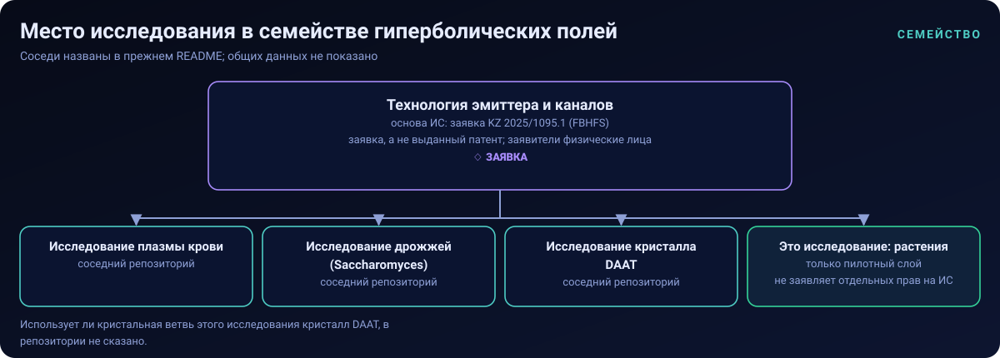
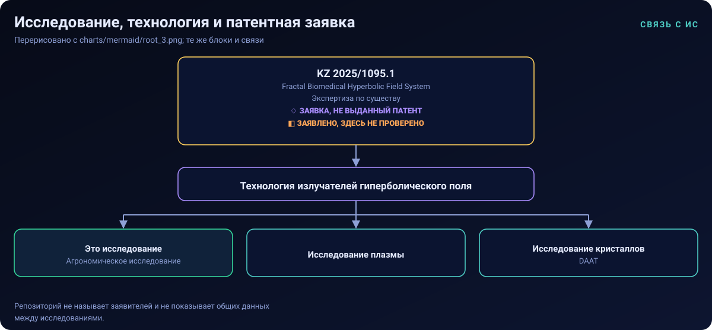

**[English](ECOSYSTEM.md) | Русский**

[← Исследование влияния гиперболических полей на сельское хозяйство](../README.ru.md) · [Указатель](README.ru.md)

# ИС, команда и экосистема

## Связь с патентом

Исследование относится к исследовательскому семейству **гиперболических полей** ASRP и использует технологию эмиттера и каналов, лежащую в основе заявки **Fractal Biomedical System (FBHFS)**, общей для исследований гиперболического поля (плазма крови, дрожжи, кристалл, сельское хозяйство). Эта заявка — **патентная заявка KZ 2025/1095.1: заявка, а не выданный патент**. Прежний README описывает её как проходящую экспертизу по существу; независимого подтверждения этого статуса в репозитории нет. Данное агрономическое исследование носит поисковый характер и не заявляет отдельных прав на интеллектуальную собственность.

Репозиторий не называет заявителей. Заявка — не выданный патент. Прежний README упоминает компанию только в блоке контактов и нигде не говорит, что она владеет каким-либо патентом.

| Патент | Заявка | Ссылка |
|---|---|---|
| **Фрактальная биомедицинская система** | KZ 2025/1095.1 | [Просмотр](https://github.com/denisbanchenko/Kazpatent_Fractal_Biomedical_System_Patent) |

Исходная схема: [`charts/mermaid/root_3.png`](../charts/mermaid/root_3.png)

## Команда

| ФИО | Роль | Обязанности |
|---|---|---|
| **Валерия Овсянникова** | Директор департамента биомедицинских исследований; главный исследователь и руководитель экспериментальных работ | Автор экспериментальной программы и методологии; разработчик исследовательской инфраструктуры и аппаратных установок; проведение исследований полного цикла; физика гиперболических полей |
| **Иван Савельев** | Директор по науке и главный редактор научного журнала ASRP.science | Научное направление |
| **Михайло Капустин** | Технический директор и директор департамента ИИ и ИТ | ИТ-инфраструктура |
| **Кирилл Змиенко** | Главный ИИ-инженер | ИИ/МО анализ |
| **Александр Овсянников** | Главный инженер по аппаратному обеспечению | Электрические системы |
| **Денис Банченко** | Директор программы, автор методологии и технологии исследования | Управление проектом, физика полей |
| **Олеся Чиркова** | Консультант | Методология плазмы крови |

**Коллаборант:** SASU Point Rouge, Франция (Чиркова). Его роль в этом исследовании не описана.

## Активные задачи

Список скопирован из прежнего README (с GitHub заново не читался): <!--n:issues_done-->2<!--/n--> завершены, <!--n:issues_open-->5<!--/n--> открыты. У открытых задач по фазам сроки на Q2-Q3 2026.

| # | Название | Приоритет | Срок | Статус |
|---|---|---|---|---|
| [#1](https://github.com/AdvancedScientificResearchProjects/Hyperbolic_Field_Agricultural_Study/issues/1) | Протокол исследования v8.3 | — | — | Завершено |
| [#3](https://github.com/AdvancedScientificResearchProjects/Hyperbolic_Field_Agricultural_Study/issues/3) | Протокол | — | — | Завершено |
| [#4](https://github.com/AdvancedScientificResearchProjects/Hyperbolic_Field_Agricultural_Study/issues/4) | Фаза прорастания (15 дней) | Высокий | Q2 2026 | Открыто |
| [#5](https://github.com/AdvancedScientificResearchProjects/Hyperbolic_Field_Agricultural_Study/issues/5) | Фаза роста (60-90 дней) | Высокий | Q2-Q3 2026 | Открыто |
| [#6](https://github.com/AdvancedScientificResearchProjects/Hyperbolic_Field_Agricultural_Study/issues/6) | Стресс-тест | Средний | Q3 2026 | Открыто |
| [#7](https://github.com/AdvancedScientificResearchProjects/Hyperbolic_Field_Agricultural_Study/issues/7) | Анализ обработки воды | Средний | Q3 2026 | Открыто |
| [#8](https://github.com/AdvancedScientificResearchProjects/Hyperbolic_Field_Agricultural_Study/issues/8) | Валидация кристаллов | Средний | Q3 2026 | Открыто |

## Контекст космического земледелия

Внешние программы, названные в прежнем README только как контекст; у исследования нет зависимости по данным ни от одной из них.

| Программа | Организация | Год | Достижение |
|---|---|---|---|
| **NASA Veggie** | NASA | 2014+ | Выращивание на МКС |
| **APH** | NASA | 2017+ | Продвинутая среда |
| **Chang'e-4** | CNSA | 2019 | Первое растение на Луне |
| **Lunar Palace 1** | BHU | 2014-2018 | 370-дневная закрытая система |
| **MELiSSA** | ESA | 1989+ | Система жизнеобеспечения |
| **EDEN-ISS** | DLR | 2018+ | Теплица в Антарктике |
| **BIOS-3** | USSR | 1965-1984 | Замкнутая экосистема |

## Экосистема ASRP

### Связанные исследовательские репозитории

| Репозиторий | Направление | Ссылка |
|---|---|---|
| **Hyperbolic Field Blood Plasma Study** | Свёртываемость плазмы | [Просмотр](https://github.com/AdvancedScientificResearchProjects/Hyperbolic_Field_BloodPlasma_Study) |
| **Hyperbolic Field DAAT Crystal Study** | Взаимодействие кристалл-человек | [Просмотр](https://github.com/AdvancedScientificResearchProjects/Hyperbolic_Field_DAAT_Crystal_Study) |
| **Hyperbolic Field Saccharomyces Study** | Ферментация дрожжей | [Просмотр](https://github.com/AdvancedScientificResearchProjects/Hyperbolic_Field_SaccharomycesCerevisiae_Study) |
| **ASRP.art** | Искусство и сознание | [Просмотр](https://github.com/AdvancedScientificResearchProjects/Axionetic_Sensing_Reactions_Platform_in_Art) |
| **UAP Reverse Engineering** | Анализ НЛО | [Просмотр](https://github.com/AdvancedScientificResearchProjects/UAP_Reverse_Engineering_Study) |
| **PLFM RADAR** | Фазированная антенная решётка | [Просмотр](https://github.com/AdvancedScientificResearchProjects/PLFM_RADAR) |

Репозиторий называет соседние исследования, но не показывает общих данных. Виден один методический след: заметки входящей партии копируют подход слепого предсказания канала из работы по плазме крови, а консультант связывает методологию плазмы.

### Патентный портфель

По списку прежнего README; статусы здесь не проверялись, и каждая строка — заявка или запись реестра, а не утверждение, что компания ею владеет.

| Патент | Заявка | Ссылка |
|---|---|---|
| **Fractal Biomedical System** | KZ 2025/1095.1 | [Просмотр](https://github.com/denisbanchenko/Kazpatent_Fractal_Biomedical_System_Patent) |
| **ASRP.art** | KZ 2025/0592.1 + PCT | [Просмотр](https://github.com/denisbanchenko/Kazpatent_Axionetic_Sensing_Reactions_Platform_in_Art_Patent) |
| **ASRP.drift** | KZ 413554 | [Просмотр](https://github.com/denisbanchenko/Kazpatent_Advanced_Synchro_Resonance_Platform_For_Deep_Resonant_Patent) |
| **GFS** | KZ 2025/1096.1 | [Просмотр](https://github.com/denisbanchenko/Kazpatent_Global_Forecasting_System_Patent) |

## Поддержка

Если эта работа вам полезна, организация просит о поддержке: [7 уровней меценатства](https://asrp.tech/en/patrons) — от Главного Филантропа до Индивидуального Вкладчика. Инвестиционные запросы: в ожидании, URL пока не указан.
