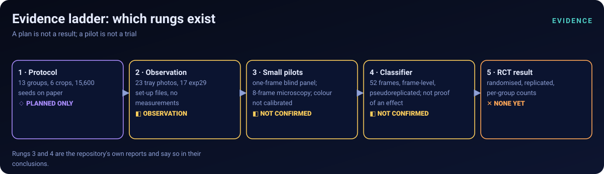

**English | [Русский](EVIDENCE.ru.md)**

[← Hyperbolic Field Agricultural Study](../README.md) · [Guide index](README.md)

# Evidence: claimed versus shown

## Claimed versus shown

**In one sentence:** the study has a complete plan and a small pilot layer, and **no result**. The plan states targets; the pilot reports say, in their own conclusions, that their signals are preliminary and not proof of a treatment effect. What follows is the full table, each row with the file it comes from. A plan, a protocol or a "will" is never counted as a result.

## What the files show

Status words: **proven** = a statement the repository's own files support (often a limit, since the data is thin); **claimed** = stated but not shown; **not yet done** = planned or begun, with no result in the repository. Sources are `path:line`.

| Status | Statement | Source |
|---|---|---|
| proven | The repository states that no quantitative results exist yet; README targets are hypotheses | `README.md:60` |
| proven | The goal ranges (T50 -20–40%, germination +10–20% and so on) are planned targets, not data | `README.md:60` |
| proven | No photo is attributed to any of the <!--n:rct_bins-->13<!--/n--> RCT bins; CH19 and CH21 have zero photos | `data/README.md:96` |
| proven | The only in-frame labelled irradiated/control pea pair has an uncontrolled mould confound | `data/photos/README.md:80` |
| proven | Radish panel: <!--n:llm_correct-->10<!--/n--> of <!--n:llm_runs-->10<!--/n--> runs picked the treated side (5 per orientation, confidence 60-70); recomputed from `runs.json` | `reports/2026-06-16_llm-blind-photo/report_en.md:84` |
| proven | Pixel metrics did NOT confirm the model's perceptual preference on the radish frame | `reports/2026-06-16_llm-blind-photo/report_en.md:102` |
| proven | The radish p-value is descriptive only; runs are one model on one frame, not independent | `reports/2026-06-16_llm-blind-photo/report_en.md:104` |
| proven | At exp29 set-up (12 h soak) three blind model observers saw no effect; this only confirms the set-up | `reports/2026-06-29_exp29-setup-observation/report_ru.md:10` |
| proven | 8-frame microscopy pilot: ExG 12.2 vs 16.6, green fraction 0.12 vs 0.20; preliminary, partly white-balance dependent | `reports/2026-07-02_microscopy-cell-structure/report_en.md:14` |
| proven | Greenness cannot be attributed to treatment on uncalibrated phone-eyepiece frames | `reports/2026-07-02_microscopy-cell-structure/report_en.md:45` |
| proven | Cell shape (circularity) shows no treated-vs-control difference; cell size could not be measured (no scale) | `reports/2026-07-02_microscopy-cell-structure/report_en.md:41` |
| proven | <!--n:frames_total-->52<!--/n-->-frame set (<!--n:frames_control-->34<!--/n--> control, <!--n:frames_treated-->18<!--/n--> treated): balanced accuracy 0.921, permutation p=0.001, frame-level and leakage-inflated by the report's own admission | `reports/2026-07-03_pattern-embedding-analysis/report_en.md:42` |
| proven | Nuclear area fraction medians 0.094 vs 0.146 (also density 7.5 vs 11.4); reproduced from the committed `per_frame_metrics.json` | `reports/2026-07-03_pattern-embedding-analysis/report_en.md:55` |
| proven | A blind model panel on 16 balanced frames scored 51%, which is chance | `reports/2026-07-03_pattern-embedding-analysis/report_en.md:68` |
| proven | The 07-02 greenness result does not reproduce on the 52-frame set (g_chroma 0.514 vs 0.517) | `reports/2026-07-03_pattern-embedding-analysis/report_en.md:71` |
| proven | The report's own conclusion: distinguishable at frame level, but not proof of a treatment effect (pseudoreplication, uncontrolled capture) | `reports/2026-07-03_pattern-embedding-analysis/report_en.md:91` |
| claimed | An RCT of the field on germination, growth and yield across <!--n:crops-->6<!--/n--> crops and <!--n:substrates-->8<!--/n--> substrates; the protocol v8.3 text is not in the repository | `README.md:58` |
| claimed | <!--n:seeds_total-->15,600<!--/n--> seeds (<!--n:rct_bins-->13<!--/n--> groups x <!--n:seeds_per_group-->200<!--/n--> x <!--n:crops-->6<!--/n--> crops) is a design number, not an executed trial | `README.md:104` |
| claimed | Channel 14 mutagenesis (new plant varieties): no data anywhere in the repository | `README.md:135` |
| claimed | Above 80% survival in Mars/Moon regolith simulants is a target; no regolith data exists | `README.md:118` |
| claimed | A crystal-mediated arm is designed but unexecuted; which crystal is used is not stated | `README.md:121` |
| claimed | Biological plausibility of the pattern signal is interpretation, flagged weak by the report | `reports/2026-07-03_pattern-embedding-analysis/report_en.md:82` |
| claimed | Only coherence and nuclei density survive Bonferroni; nuclear area fraction is marginal | `reports/2026-07-03_pattern-embedding-analysis/report_en.md:65` |
| claimed | Percipient impressions on plant trays: subjective, n=3, post-hoc codes; hypothesis generation only | `reports/percipient_reports/PLANT_CENSOR_EVIDENCE_SO_FAR.md:5` |
| claimed | Fractal "censor" sessions were not blind; the summary rates them as suggestion with zero evidential value | `reports/percipient_reports/PLANT_CENSOR_EVIDENCE_SO_FAR.md:49` |
| not yet done | Exp29 was laid down on 2026-06-29; its growth-stage result is expected, not present | `protocols/2026-06-29_exp29-irradiated-germination.md:4` |
| not yet done | The ~7-month schedule is planned; issues #4 to #8 are still open | `README.md:100` |
| not yet done | Cross-model, replicated, fixed-geometry imaging and independent morphometry for the radish pilot | `reports/2026-06-16_llm-blind-photo/report_en.md:119` |
| not yet done | Urgent analysis and blind channel prediction of the 2026-07-08 batch | `data/incoming/2026-07-08_earlier-samples/MANIFEST.md:47` |
| not yet done | A blind plant protocol with percipients was being designed on 2026-07-07; the key holds <!--n:plant_key_rows-->6<!--/n--> frames and no results | `reports/percipient_reports/PLANT_CENSOR_EVIDENCE_SO_FAR.md:8` |
| not yet done | The 3 group-coding systems of the exp29 macro photos must be reconciled before morphometry | `data/incoming/2026-07-08_earlier-samples/DESCRIPTIONS.md:42` |

## How to read the evidence

The study sits on rungs 1 to 4 of a five-rung ladder; rung 5, a randomised and replicated result with per-group counts, does not exist. Two rules help when reading the reports. First, a **model panel is not a measurement**: the radish result is one model family judging one frame, and its stated reasons were not confirmed by pixels. Second, a **separable set of frames is not an effect**: the 52-frame classifier was trained and tested on frames from a few captures, which the report calls pseudoreplication. Fixed capture (one white balance, exposure and zoom, control and treated in one frame, at least five leaves per group) is what both microscopy reports ask for.
