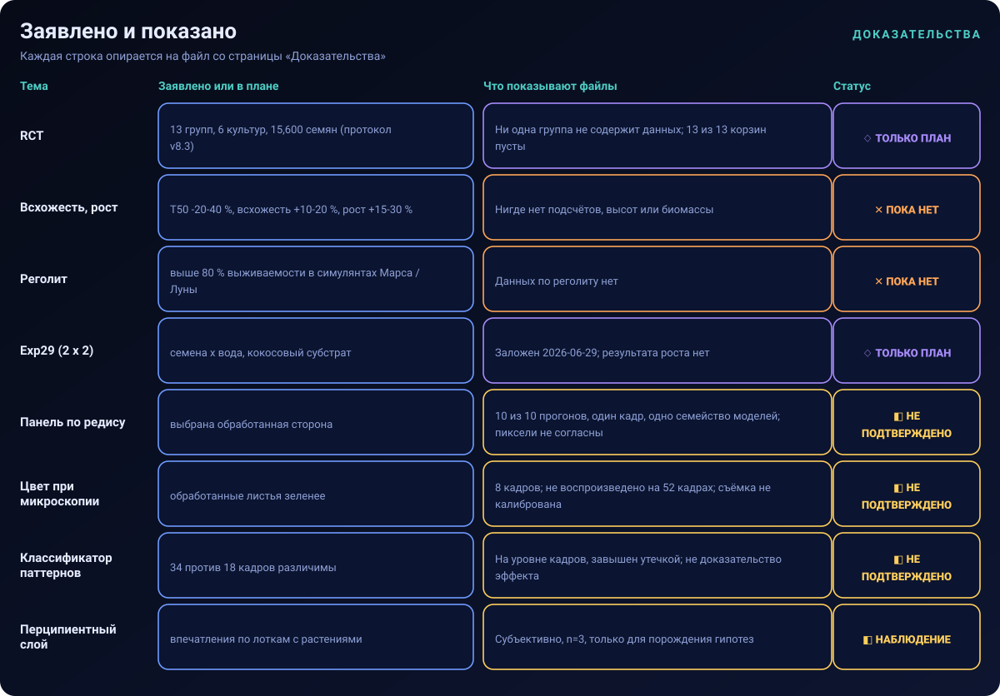
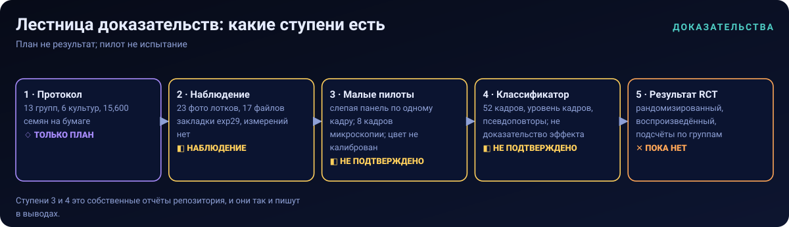

**[English](EVIDENCE.md) | Русский**

[← Исследование влияния гиперболических полей на сельское хозяйство](../README.ru.md) · [Указатель](README.ru.md)

# Доказательства: заявлено и показано

## Заявлено и показано

**В одном предложении:** у исследования есть полный план и небольшой пилотный слой, и **нет результата**. План называет целевые значения; пилотные отчёты сами пишут в выводах, что их сигналы предварительны и не доказывают эффекта обработки. Ниже полная таблица, у каждой строки файл-источник. План, протокол или «будет» никогда не считаются результатом.

## Что показывают файлы

Слова-статусы: **доказано** = утверждение, которое поддерживают собственные файлы репозитория (часто это ограничение, так как данных мало); **заявлено** = сказано, но не показано; **ещё не сделано** = запланировано или начато, результата в репозитории нет. Источники — `путь:строка`.

| Статус | Утверждение | Источник |
|---|---|---|
| доказано | Репозиторий сам указывает, что количественных результатов пока нет; цели README — гипотезы | `README.md:60` |
| доказано | Диапазоны целей (T50 -20–40%, всхожесть +10–20% и т.д.) — плановые значения, не данные | `README.md:60` |
| доказано | Ни одно фото не привязано ни к одной из <!--n:rct_bins-->13<!--/n--> корзин RCT; для CH19 и CH21 фото ноль | `data/README.md:96` |
| доказано | Единственная маркированная в кадре пара облучённый/контроль (горох) имеет неконтролируемый конфаундер: плесень | `data/photos/README.md:80` |
| доказано | Панель по редису: <!--n:llm_correct-->10<!--/n--> из <!--n:llm_runs-->10<!--/n--> прогонов выбрали обработанную сторону (по 5 на ориентацию, уверенность 60-70); пересчитано из `runs.json` | `reports/2026-06-16_llm-blind-photo/report_en.md:84` |
| доказано | Пиксельные метрики НЕ подтвердили перцептивное предпочтение модели на кадре редиса | `reports/2026-06-16_llm-blind-photo/report_en.md:102` |
| доказано | p-значение по редису только описательное; прогоны — одна модель на одном кадре, не независимы | `reports/2026-06-16_llm-blind-photo/report_en.md:104` |
| доказано | При закладке exp29 (замачивание 12 ч) три слепых наблюдателя-модели не увидели эффекта; это лишь подтверждает закладку | `reports/2026-06-29_exp29-setup-observation/report_ru.md:10` |
| доказано | Микроскопия, пилот на 8 кадрах: ExG 12.2 против 16.6, доля зелёного 0.12 против 0.20; предварительно, отчасти зависит от баланса белого | `reports/2026-07-02_microscopy-cell-structure/report_en.md:14` |
| доказано | Зелень нельзя приписать обработке на некалиброванных кадрах «телефон через окуляр» | `reports/2026-07-02_microscopy-cell-structure/report_en.md:45` |
| доказано | Форма клеток (округлость) не различается между обработкой и контролем; размер клеток измерить не удалось (нет масштаба) | `reports/2026-07-02_microscopy-cell-structure/report_en.md:41` |
| доказано | Набор из <!--n:frames_total-->52<!--/n--> кадров (<!--n:frames_control-->34<!--/n--> контроль, <!--n:frames_treated-->18<!--/n--> обработка): сбалансированная точность 0.921, пермутационное p=0.001, уровень кадров, завышено утечкой по признанию самого отчёта | `reports/2026-07-03_pattern-embedding-analysis/report_en.md:42` |
| доказано | Медианы доли площади ядер 0.094 против 0.146 (также плотность 7.5 против 11.4); воспроизведено из закоммиченного `per_frame_metrics.json` | `reports/2026-07-03_pattern-embedding-analysis/report_en.md:55` |
| доказано | Слепая панель моделей на 16 сбалансированных кадрах дала 51%, то есть шанс | `reports/2026-07-03_pattern-embedding-analysis/report_en.md:68` |
| доказано | Результат по зелени из отчёта 07-02 не воспроизводится на наборе из 52 кадров (g_chroma 0.514 против 0.517) | `reports/2026-07-03_pattern-embedding-analysis/report_en.md:71` |
| доказано | Собственный вывод отчёта: различимо на уровне кадров, но не доказательство эффекта обработки (псевдоповторы, неконтролируемая съёмка) | `reports/2026-07-03_pattern-embedding-analysis/report_en.md:91` |
| заявлено | РКИ влияния поля на всхожесть, рост и урожай на <!--n:crops-->6<!--/n--> культурах и <!--n:substrates-->8<!--/n--> субстратах; текста протокола v8.3 в репозитории нет | `README.md:58` |
| заявлено | <!--n:seeds_total-->15,600<!--/n--> семян (<!--n:rct_bins-->13<!--/n--> групп x <!--n:seeds_per_group-->200<!--/n--> x <!--n:crops-->6<!--/n--> культур) — число дизайна, а не выполненное испытание | `README.md:104` |
| заявлено | Мутагенез на канале 14 (новые сорта растений): данных в репозитории нет нигде | `README.md:135` |
| заявлено | Выживаемость выше 80% в симулянтах реголита Марса/Луны — цель; данных по реголиту нет | `README.md:118` |
| заявлено | Ветвь с кристаллом спроектирована, но не выполнена; какой кристалл, не сказано | `README.md:121` |
| заявлено | Биологическая правдоподобность сигнала паттернов — интерпретация, отчёт сам помечает её как слабую | `reports/2026-07-03_pattern-embedding-analysis/report_en.md:82` |
| заявлено | Поправку Бонферрони переживают только когерентность и плотность ядер; доля площади ядер на границе | `reports/2026-07-03_pattern-embedding-analysis/report_en.md:65` |
| заявлено | Впечатления перципиентов по лоткам с растениями: субъективно, n=3, коды постфактум; только порождение гипотез | `reports/percipient_reports/PLANT_CENSOR_EVIDENCE_SO_FAR.md:5` |
| заявлено | Фрактальные сессии «цензоров» не были слепыми; сводка оценивает их как внушение с нулевой доказательной ценностью | `reports/percipient_reports/PLANT_CENSOR_EVIDENCE_SO_FAR.md:49` |
| ещё не сделано | Exp29 заложен 2026-06-29; результат стадии роста ожидается, его нет | `protocols/2026-06-29_exp29-irradiated-germination.md:4` |
| ещё не сделано | Расписание ~7 месяцев — план; задачи #4-#8 всё ещё открыты | `README.md:100` |
| ещё не сделано | Кросс-модельная воспроизведённая съёмка с фиксированной геометрией и независимая морфометрия для пилота по редису | `reports/2026-06-16_llm-blind-photo/report_en.md:119` |
| ещё не сделано | Срочный анализ и слепое предсказание канала для партии 2026-07-08 | `data/incoming/2026-07-08_earlier-samples/MANIFEST.md:47` |
| ещё не сделано | Слепой протокол по растениям с перципиентами проектировался 2026-07-07; ключ на <!--n:plant_key_rows-->6<!--/n--> кадров, результатов нет | `reports/percipient_reports/PLANT_CENSOR_EVIDENCE_SO_FAR.md:8` |
| ещё не сделано | 3 системы кодирования групп на макрофото exp29 нужно свести воедино до морфометрии | `data/incoming/2026-07-08_earlier-samples/DESCRIPTIONS.md:42` |

## Как читать доказательства

Исследование стоит на ступенях 1-4 пятиступенчатой лестницы; ступени 5, рандомизированного воспроизведённого результата с подсчётами по группам, не существует. Два правила помогают при чтении отчётов. Первое: **панель моделей — не измерение**: результат по редису — это одно семейство моделей, оценивающее один кадр, и его доводы пиксели не подтвердили. Второе: **различимый набор кадров — не эффект**: классификатор на 52 кадрах обучался и проверялся на кадрах из нескольких съёмок, что отчёт называет псевдоповторами. Фиксированная съёмка (один баланс белого, экспозиция и увеличение, контроль и обработка в одном кадре, не менее пяти листьев на группу) — то, чего просят оба микроскопических отчёта.
