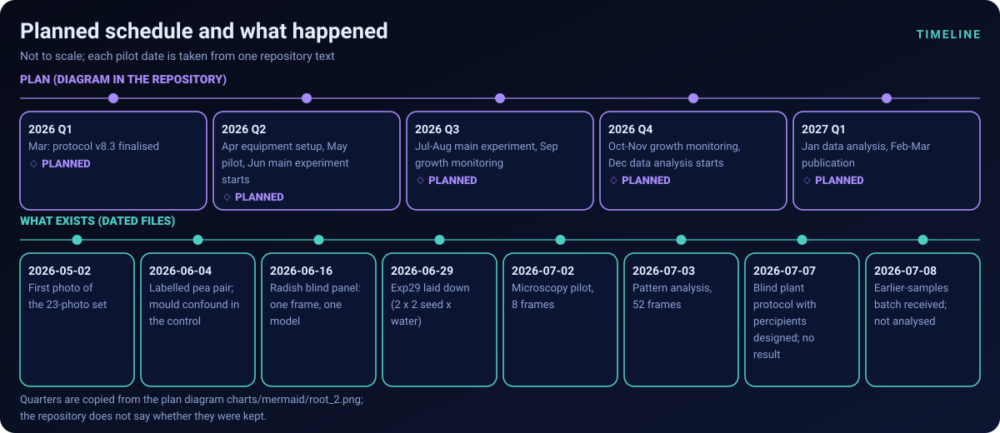

**English | [Русский](PILOT.ru.md)**

[← Hyperbolic Field Agricultural Study](../README.md) · [Guide index](README.md)

# Pilot data: what actually exists

## What exists today

The repository holds **no RCT data**. What it holds is a **pilot layer** collected between <!--n:photo_first-->2026-05-02<!--/n--> and 2026-07-08, in six parts: a set of <!--n:photos-->23<!--/n--> tray photographs, the laid-down germination experiment exp29, a blind-model comparison on one radish frame, two microscopy analyses, a subjective percipient layer and an incoming batch under review. The repository's own reports call every one of them preliminary; none is a controlled, replicated result. Per-part detail and the verdict of each report are below; the claim-by-claim table is on the [Evidence](EVIDENCE.md) page.

## The photo set

**Status: observational only, not an analysis, not confirmatory.** `data/photos/` holds **<!--n:photos-->23<!--/n--> photos** (<!--n:photos_jpeg-->18<!--/n--> JPEG + <!--n:photos_heic-->5<!--/n--> HEIC, <!--n:photo_first-->2026-05-02<!--/n--> to <!--n:photo_last-->2026-06-10<!--/n-->) of plant, pea, chickpea and microgreen trays, with one manifest entry per image. There are **no quantitative measurements** (no germination counts, T50, heights, biomass or scale bar) and channel attribution is incomplete.

- Only **one in-frame labelled pair** exists: a handwritten *irradiated* vs *control* pea/microgreen comparison from 2026-06-04 (single replicate, channel unspecified). In the control frame the microgreen tray shows **heavy white mould, an uncontrolled confound**, not a treatment effect.
- Two further 2026-06-10 microgreen photos are tagged `irradiated-ch17` **in manifest free text only** (no in-frame label, no paired control).
- **CH19 and CH21 have zero photographs.** All <!--n:rct_bins-->13<!--/n--> RCT bins (`control` + `ch17/ch19/ch21 × direct/water/crystal/combined`) are empty placeholders awaiting researcher attribution.

> **Caveat:** Nothing in the current data supports any effect-size, germination-percentage, dose-response or channel-specific claim. See [`data/README.md`](../data/README.md) for what the data hub does NOT claim, and [`data/photos/README.md`](../data/photos/README.md) for the per-image inventory.

## Exp29: a laid-down germination experiment

Experiment 29 is a 2 x 2 design (seed x water, both factors irradiated or ordinary) on a coconut substrate, laid down on **2026-06-29** after a 12-hour soak; the protocol ([`protocols/2026-06-29_exp29-irradiated-germination.md`](../protocols/2026-06-29_exp29-irradiated-germination.md), Russian only) expected a result about three days later. The repository holds the set-up photos and a handwritten protocol (<!--n:exp29_setup_files-->17<!--/n--> files in `data/exp29-setup/`) and a set-up observation report ([`reports/2026-06-29_exp29-setup-observation/report_ru.md`](../reports/2026-06-29_exp29-setup-observation/report_ru.md)): at the 12-hour soak stage three blind model observers saw no effect, which only confirms that the set-up happened. **There is no growth-stage result.** The macro photos of this set carry three inconsistent group-coding systems that must be reconciled before any measurement ([incoming batch](#the-incoming-batch)).

## The radish blind panel (2026-06-16)

One photo of radish microgreens (a tray frame captured on 2026-05-11, treated side vs control) was shown blind to one model family, <!--n:llm_runs-->10<!--/n--> times: <!--n:llm_per_orientation-->5<!--/n--> runs with the treated side on the right and <!--n:llm_per_orientation-->5<!--/n--> with the image flipped. **<!--n:llm_correct-->10<!--/n--> of <!--n:llm_runs-->10<!--/n-->** runs picked the treated side (mean confidence <!--n:llm_conf-->67<!--/n-->). The verdict flips with the image, which rules out a fixed left-right bias, but the report itself states the limits: one frame, one model family (<!--n:llm_families-->1<!--/n-->), runs not independent, so the nominal p-value is descriptive only; and **pixel metrics did not confirm** the model's reasons (leaf size, canopy density). Cross-model, replicated, fixed-geometry imaging is still needed. Data: [`results/llm_blind/`](../results/llm_blind/runs.json); report: [`reports/2026-06-16_llm-blind-photo/report_en.md`](../reports/2026-06-16_llm-blind-photo/report_en.md).

## Two microscopy analyses of broccoli microgreen

| Report | Frames | What it found | What the report itself says about it |
|---|---|---|---|
| [2026-07-02 colour and cell structure](../reports/2026-07-02_microscopy-cell-structure/report_en.md) | <!--n:micro_report_frames-->8<!--/n--> (3 control, 5 treated per the report) | treated frames greener (ExG 12.2 vs 16.6, green fraction 0.12 vs 0.20); no shape difference; cell size not measurable | preliminary; colour partly depends on phone white balance and exposure; cannot be attributed to treatment |
| [2026-07-03 pattern and embeddings](../reports/2026-07-03_pattern-embedding-analysis/report_en.md) | <!--n:frames_total-->52<!--/n--> (<!--n:frames_control-->34<!--/n--> control, <!--n:frames_treated-->18<!--/n--> treated) | classifier balanced accuracy 0.921, permutation p=0.001; nuclear area fraction medians 0.094 vs 0.146; the 07-02 greenness did **not** reproduce; a 16-frame blind model panel scored 51%, chance | frames are distinguishable but this is not proof of a treatment effect: pseudoreplication, leakage, uncontrolled capture |

The numbers of the 07-03 report can be recomputed from the committed [`per_frame_metrics.json`](../reports/2026-07-03_pattern-embedding-analysis/data/per_frame_metrics.json).

## The percipient layer

A small subjective layer: impressions of percipients on photographs of plant trays, summarised in [`reports/percipient_reports/`](../reports/percipient_reports/). The summary itself rates it as **hypothesis-generating, not measurement** (n=3, codes assigned afterwards, no scales); fractal "censor" sessions were not blind and carry no evidential value. As of 2026-07-07 a blind plant protocol was being designed; the key file for <!--n:plant_key_rows-->6<!--/n--> frames exists but **holds no results**. Participant files are not described on these pages.

## The incoming batch

[`data/incoming/2026-07-08_earlier-samples/`](../data/incoming/2026-07-08_earlier-samples/MANIFEST.md) stages earlier samples received on 2026-07-08 (macro growth photos of 2026-06-29, a first-day photo, extra microscopy frames; media are git-ignored). Its own descriptions say that group labels are in three incompatible coding systems and that no frame has a scale bar or colour reference. The researcher's intent, urgent analysis and blind channel prediction, is **not yet done**.
