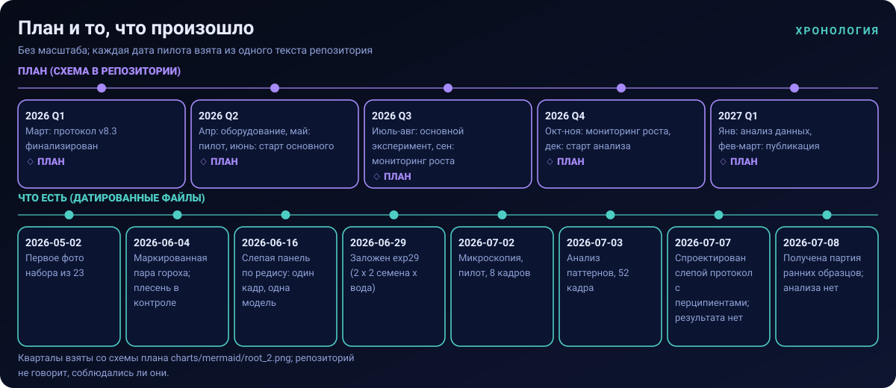

**[English](PILOT.md) | Русский**

[← Исследование влияния гиперболических полей на сельское хозяйство](../README.ru.md) · [Указатель](README.ru.md)

# Пилотные данные: что есть на самом деле

## Что есть сегодня

В репозитории **нет данных RCT**. Есть **пилотный слой**, собранный между <!--n:photo_first-->2026-05-02<!--/n--> и 2026-07-08, из шести частей: набор из <!--n:photos-->23<!--/n--> фотографий лотков, заложенный эксперимент прорастания exp29, слепое сравнение моделей на одном кадре редиса, два микроскопических анализа, субъективный перципиентный слой и входящая партия на рассмотрении. Собственные отчёты репозитория называют каждую из них предварительной; ни одна не является контролируемым воспроизведённым результатом. Подробности по частям и вердикт каждого отчёта — ниже; таблица по утверждениям — на странице [Доказательства](EVIDENCE.ru.md).

## Набор фотографий

**Статус: только наблюдение, не анализ, не подтверждение.** В `data/photos/` лежат **<!--n:photos-->23<!--/n--> фото** (<!--n:photos_jpeg-->18<!--/n--> JPEG + <!--n:photos_heic-->5<!--/n--> HEIC, 02.05.2026 → 10.06.2026) лотков с растениями, горохом, нутом и микрозеленью, по одной записи манифеста на изображение. **Количественных измерений нет** (нет подсчётов всхожести, T50, высот, биомассы или масштабной линейки), атрибуция по каналам неполная.

- Существует только **одна маркированная в кадре пара**: рукописное сравнение *облучённые* vs *контроль* (горох/микрозелень) от 04.06.2026 (один повтор, канал не указан). В контрольном кадре на лотке микрозелени **обильная белая плесень — неконтролируемый конфаундер**, а не эффект обработки.
- Ещё две фотографии микрозелени от 10.06.2026 помечены `irradiated-ch17` **только в свободном тексте манифеста** (нет метки в кадре, нет парного контроля).
- **Для CH19 и CH21 фотографий ноль.** Все <!--n:rct_bins-->13<!--/n--> корзин RCT (`control` + `ch17/ch19/ch21 × direct/water/crystal/combined`) — пустые плейсхолдеры, ожидающие атрибуции руководителя.

> **Оговорка:** ничто в текущих данных не подтверждает какое-либо утверждение о размере эффекта, проценте всхожести, дозозависимости или специфике канала. См. [`data/README.md`](../data/README.md) — чего хаб данных НЕ утверждает, и [`data/photos/README.md`](../data/photos/README.md) — поэлементный список.

## Exp29: заложенный эксперимент прорастания

Эксперимент 29 — дизайн 2 x 2 (семена x вода, оба фактора облучённые или обычные) на кокосовом субстрате, заложен **2026-06-29** после 12-часового замачивания; протокол ([`protocols/2026-06-29_exp29-irradiated-germination.md`](../protocols/2026-06-29_exp29-irradiated-germination.md), только на русском) ожидал результат примерно через три дня. В репозитории есть фото закладки и рукописный протокол (<!--n:exp29_setup_files-->17<!--/n--> файла в `data/exp29-setup/`) и отчёт о наблюдении закладки ([`reports/2026-06-29_exp29-setup-observation/report_ru.md`](../reports/2026-06-29_exp29-setup-observation/report_ru.md)): на стадии 12-часового замачивания три слепых наблюдателя-модели не увидели эффекта, что лишь подтверждает факт закладки. **Результата стадии роста нет.** Макрофото этого набора несут три несогласованные системы кодирования групп, которые нужно свести воедино до любых измерений ([входящая партия](#входящая-партия)).

## Слепая панель по редису (2026-06-16)

Одно фото микрозелени редиса (кадр лотка, снятый 2026-05-11, обработанная сторона против контроля) показали вслепую одному семейству моделей <!--n:llm_runs-->10<!--/n--> раз: <!--n:llm_per_orientation-->5<!--/n--> прогонов с обработанной стороной справа и <!--n:llm_per_orientation-->5<!--/n--> с отражённым изображением. **<!--n:llm_correct-->10<!--/n--> из <!--n:llm_runs-->10<!--/n-->** прогонов выбрали обработанную сторону (средняя уверенность <!--n:llm_conf-->67<!--/n-->). Вердикт переворачивается вместе с изображением, что исключает фиксированный левый-правый сдвиг, но отчёт сам называет ограничения: один кадр, одно семейство моделей (<!--n:llm_families-->1<!--/n-->), прогоны не независимы, поэтому номинальное p-значение только описательное; а **пиксельные метрики не подтвердили** доводы модели (размер листа, плотность полога). Нужна съёмка с фиксированной геометрией, кросс-модельная и воспроизведённая. Данные: [`results/llm_blind/`](../results/llm_blind/runs.json); отчёт: [`reports/2026-06-16_llm-blind-photo/report_ru.md`](../reports/2026-06-16_llm-blind-photo/report_ru.md).

## Два микроскопических анализа микрозелени брокколи

| Отчёт | Кадры | Что найдено | Что сам отчёт говорит об этом |
|---|---|---|---|
| [2026-07-02 цвет и строение клеток](../reports/2026-07-02_microscopy-cell-structure/report_ru.md) | <!--n:micro_report_frames-->8<!--/n--> (по отчёту 3 контроль, 5 обработка) | обработанные кадры зеленее (ExG 12.2 против 16.6, доля зелёного 0.12 против 0.20); разницы формы нет; размер клеток не измерим | предварительно; цвет отчасти зависит от баланса белого и экспозиции телефона; нельзя приписать обработке |
| [2026-07-03 паттерны и эмбеддинги](../reports/2026-07-03_pattern-embedding-analysis/report_ru.md) | <!--n:frames_total-->52<!--/n--> (<!--n:frames_control-->34<!--/n--> контроль, <!--n:frames_treated-->18<!--/n--> обработка) | сбалансированная точность классификатора 0.921, пермутационное p=0.001; медианы доли площади ядер 0.094 против 0.146; зелень из отчёта 07-02 **не** воспроизвелась; слепая панель моделей на 16 кадрах дала 51%, то есть шанс | кадры различимы, но это не доказательство эффекта обработки: псевдоповторы, утечка, неконтролируемая съёмка |

Числа отчёта 07-03 можно пересчитать из закоммиченного [`per_frame_metrics.json`](../reports/2026-07-03_pattern-embedding-analysis/data/per_frame_metrics.json).

## Перципиентный слой

Небольшой субъективный слой: впечатления перципиентов по фотографиям лотков с растениями, собранные в сводку в [`reports/percipient_reports/`](../reports/percipient_reports/). Сама сводка оценивает его как **генерацию гипотез, а не измерение** (n=3, коды назначены постфактум, без шкал); фрактальные сессии «цензоров» не были слепыми и не имеют доказательной ценности. На 2026-07-07 проектировался слепой протокол по растениям; файл ключа на <!--n:plant_key_rows-->6<!--/n--> кадров существует, но **результатов в нём нет**. Файлы участников приватны и на этих страницах не описываются.

## Входящая партия

[`data/incoming/2026-07-08_earlier-samples/`](../data/incoming/2026-07-08_earlier-samples/MANIFEST.md) хранит ранние образцы, полученные 2026-07-08 (макрофото роста от 2026-06-29, фото первого дня, дополнительные кадры микроскопии; медиа в .gitignore). Её собственные описания говорят, что метки групп записаны в трёх несовместимых системах кодирования и что ни на одном кадре нет масштабной линейки или цветового эталона. Намерение исследователя — срочный анализ и слепое предсказание канала — **пока не выполнено**.
